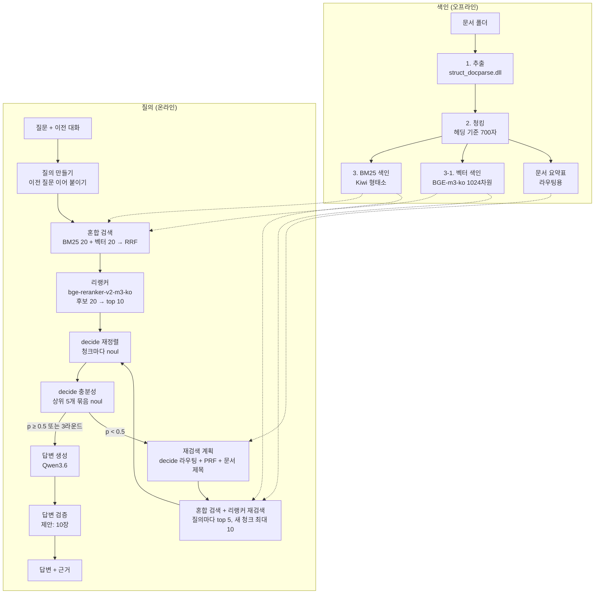

# DecideRAG 설계서 — BM25 + 벡터 + 리랭크 + decide 판단 Agentic RAG

- 작성일: 2026-11-26 (2026-11-27 구성 변경)
- 근거 프로토타입: `D:\Project\Q&A\AgenticRAG` (6개 구성 비교 결과는 `out\v2\report.html`)
- 결정 (2026-11-27 바꿈, 근거 14.7.2):
  - 검색: **BM25 + 벡터(dragonkue/BGE-m3-ko) 혼합(RRF) → 한국어 리랭커(bge-reranker-v2-m3-ko)**
  - 에이전트 판단: **kanana-2-v-decide**
  - 답변: **Qwen3.6**
- 처음 결정(2026-11-26)은 "BM25 만, 벡터 없음" 이었다. 1~6단계는 그 구성으로 만들고 쟀다. 새 구성은 7단계에서 서비스에 반영했다 (14.8).

이 문서에서 **[측정]** 은 프로토타입이나 이번 개발에서 잰 값이고, **[제안]** 은 아직 구현·측정하지 않은 설계다.

---

## 1. 목표와 범위

### 1.1 목표
1. 회사 문서(doc/docx/pdf/pptx/hwp/hwpx/xlsx 등)에 대해 질문하면 근거 번호를 붙여 답한다. 운영 규모는 문서 최대 10만 개, 청크 최대 100만 개다 (12장).
2. 판단(관련성 재정렬, 근거 충분성, 재검색 계획)은 생성 LLM 대신 판단 모델 decide 가 맡는다. 생성 LLM 은 답변을 쓸 때 한 번만 부른다.
3. 문서에 없는 내용을 물으면 지어내지 않고 "찾을 수 없습니다"로 답한다.
4. 멀티턴 대화("그럼 배우자 부모님은?")를 처리한다.
5. 사용자·부서마다 볼 수 있는 문서가 다르다. 권한 없는 문서는 검색·판단·답변 어디에도 쓰지 않는다 (12.4).
6. 질문과 문서의 단어가 달라도("장가가는데" ↔ "본인 결혼") 근거를 찾는다. 그래서 BM25 에 벡터 검색을 더하고 리랭커로 다시 줄 세운다 (14.7.2).

### 1.2 범위 밖 (이번 판)
- 웹 UI. 이번 판은 HTTP API 와 CLI 만 만든다.
- (2026-11-26 판에서 범위 밖이던 "벡터 검색과 임베딩 DB" 는 2026-11-27 범위 안으로 옮겼다. 14.7.2)

---

## 2. 왜 decide 판단인가, 왜 벡터·리랭커를 더했나 (측정 근거)

평가셋은 Claude 가 만든 100문항이다. 답할 수 있는 90문항으로 채점했고 판정자도 Claude 다. 아래 값은 모두 **[측정]** 이다.

| 구성 | Faithfulness | Answer Relevancy | Context Precision | Context Recall | Answer Correctness | 판단 시간 평균 |
|---|---|---|---|---|---|---|
| BM25 (판단 없음) | 0.957 | 0.770 | 0.817 | 0.910 | 0.723 | – |
| **BM25+decide** | 0.936 | 0.806 | 0.894 | 0.960 | 0.760 | **1.44초** |
| BM25+qwen 판단 | 0.968 | 0.787 | 0.942 | 0.946 | 0.741 | 3.50초 |
| BM25+하이브리드 (decide 판단 + qwen 재작성) | 0.948 | 0.804 | 0.899 | 0.959 | 0.763 | 1.95초 |
| BM25+벡터+decide | 0.960 | 0.814 | 0.913 | 0.981 | 0.762 | 1.67초 |

- 판단 시간: decide 는 qwen 판단의 약 41% 다 (1.44초 대 3.50초).
- Answer Correctness: 6개 구성 사이에 통계적으로 의미 있는 차이가 없다. 예를 들어 BM25+decide − BM25 는 +0.037, 95% 구간은 [−0.009, +0.086] 이다.
- 벡터 검색을 더하면 Context Recall 이 +0.021 오르지만 정답률은 차이가 없다. 그래서 2026-11-26 판은 벡터 없이 갔다. 2026-11-27 재측정으로 바꿨다 (2.1).

BM25+decide 의 세부 측정값:

| 항목 | 값 |
|---|---|
| 전체 응답 시간 | 평균 2.93초 · p50 2.64초 · p90 4.47초 |
| 판단 시간 | 평균 1.44초 · p50 1.09초 · p90 3.04초 |
| 답변(Qwen) 시간 | 평균 1.48초 · p90 1.91초 |
| BM25 검색 시간 | 평균 0.01초 |
| 질문당 decide 호출 수 / 입력 토큰 | 14.6회 / 약 5,958 토큰 |
| 라운드 수 분포 (100문항) | 1라운드 82 · 2라운드 6 · 3라운드 12 (재검색률 18%) |
| 정답 근거가 문맥에 들어간 비율 | 94.1% |
| 답이 있는데 거절한 비율 | 5.6% |
| 문서에 없는 질문을 거절한 비율 | 100% (10건) |
| 유형별 Answer Correctness | single 0.840 · multi 0.755 · **reasoning 0.638** · 일상어 0.737 · 정형어 0.832 |

**결론:** 병목은 검색이나 판단보다 **답변 단계**다. 특히 추론 문항에서 계산을 틀리거나 조건을 잘못 적용하는 문제가 크다. 10장의 개선 항목은 여기에 집중한다.

### 2.1 구성을 바꾼 근거 (2026-11-27 재측정, 14.7 · 14.7.1 · 14.7.2)

1~6단계 코드에 벡터·리랭커를 붙여 같은 시간대에 다시 쟀다. 모두 **[측정]** 이다.
- 답변 단계는 A3·A4 켬, 색인은 A6 보정이다.
- 단어 불일치 75문항은 질문이 문서 단어를 거의 쓰지 않게 바꿔 쓴 문항이다 (12.1.2).

| 구성 | 정답률 (90문항) | 답이 있는데 거절 | 단어 불일치 근거 포함률 | 응답 p90 |
|---|---|---|---|---|
| BM25+decide (1~6단계) | 0.772 | 2.2% | 0.403 | 4.96초 |
| BM25+벡터(BGE-m3-ko)+decide | 0.766 | 3.3% | 0.859 | 5.84초 |
| BM25+벡터(BGE-m3-ko)+리랭크 | 0.782 | 6.7% | 0.862 | **2.29초** |
| **BM25+벡터(BGE-m3-ko)+리랭크+decide (채택)** | **0.796** | **0.0%** | **0.870** | 6.27초 |

- 채택 구성은 BM25+decide 대비 정답률 +0.024 [−0.002, +0.055], 단어 불일치 근거 포함률 +0.467 [+0.350, +0.581] 이다.
- 같은 구성에서 decide 를 빼면 정답률 차이는 +0.015 [−0.020, +0.052] 로 확인되지 않았다. 다만 거절이 6.7% 로 늘었다. decide 의 충분성 판단과 A3 재시도가 거절을 막는다.
- 대가는 두 가지다.
  - 응답 p90 6.27초로 9장 목표 5초를 넘는다.
  - GPU 서버에 임베딩·리랭커가 더 올라간다.
  - 줄일 방법은 13장 · 14장 7단계에서 다룬다.
- 임베딩만 바꾼 비교(BGE-m3-ko − e5-small-ko, 벡터+decide): 정답률 −0.006 [−0.041, +0.025], 단어 불일치 근거 포함률 +0.128 [+0.052, +0.213].
- 리랭커는 한국어 파인튜닝 모델이어야 했다. 영어·중국어 위주 `bge-reranker-base` 는 정답률 0.688 로 가장 나빴다 (14.7).

---

## 3. 전체 구조



| 단계 | 담당 | 장비 |
|---|---|---|
| 추출·청킹·BM25 | 이 서비스 (Python) + OpenSearch | CPU |
| 임베딩 (색인할 때 청크, 질문마다 질의 1회) | BGE-m3-ko (`10.10.4.10:18002`, vLLM) | A30 GPU 서버 |
| 리랭크 (검색 요청마다 후보 20개) | bge-reranker-v2-m3-ko (`10.10.4.10:18003`, vLLM) | A30 GPU 서버 |
| 재정렬·충분성·라우팅 | decide (`10.10.4.10:18004`) | A30 GPU 서버 |
| 답변 생성 | Qwen3.6 (`192.168.0.14:8082`) | MLX 서버 |

- 지금은 A30 한 장에 임베딩·리랭커·decide 가 함께 있다 ([측정] 세 개가 떠 있을 때 GPU 메모리 약 7.5GB(decide) + 리랭커 최대 3.6GB + 임베딩 최대 4.8GB 몫).

---

## 4. 구성요소 설계

### 4.1 추출 — `extract`
- 파서는 `D:\Project\Struct-DocParse-OCR-rust` 의 `struct_docparse.dll` 이다. 판 0.2.0 의 `dist\struct_docparse-0.2.0-9662220-windows-x64\lib\` 를 쓴다.
- 호출은 저장소에 있는 ctypes 바인딩 `bindings\python\struct_docparse.py` 의 `DocParser(dll, {"ocr": {"mode": "inline"}})` 와 `.parse(path)`, `.close()` 다.
- DLL 은 자기 옆 폴더에서 pdfium·onnxruntime·OCR 모델을 찾는다. 그래서 `lib\` 폴더를 통째로 둔다.
- 블록 라벨 가운데 `header` · `footer` · `page_number` · `toc` 와 빈 글은 버린다.
- 문서 ID 는 **[제안]** 파일 경로 해시로 정한다. 프로토타입은 파일 이름 순서로 D01, D02… 를 붙였는데, 이 방식은 문서를 추가하면 번호가 밀린다.
- 문서 하나가 실패해도 기록만 남기고 다음 문서로 넘어간다.
- 결과는 `data\parsed\<doc_id>.json` 에 저장한다.

**알려진 문제 [측정]:** 청탁금지법 PDF 2건은 원본 PDF 의 텍스트 층에서 숫자가 빠져 있다("제 조제 항", "회 만원"). PyMuPDF 로 뽑아도 같다. **[제안]** 숫자 빠짐 패턴이 보이는 쪽은 OCR 로 다시 뽑는다 (`ocr_pages`).

### 4.2 청킹 — `chunker`
프로토타입의 규칙을 그대로 쓴다.
- 헤딩 블록에서 끊는다. "사례 N" 이나 "Q1" 처럼 짧은 문단도 헤딩으로 본다.
- 본문은 최대 700자다. 150자보다 짧은 조항은 다음 조항과 합친다.
- 긴 표는 머리글 줄을 반복해 넣으며 나눈다. 긴 문단은 문장 경계에서 나눈다.
- 청크 앞에 `[문서제목 > 헤딩 경로]` 를 붙인다. BM25 에 제목 단어가 걸리게 하고, decide 가 출처를 알게 하기 위해서다.
- [측정] 문서 18개에서 청크 606개가 나왔다.

청크 형식:

```json
{"chunk_id": "<doc_id>#012", "doc_id": "...", "title": "복리후생규정",
 "path": ["제3장 경조금", "제12조 경조금 지급"], "page": 4,
 "body": "본문", "text": "[복리후생규정 > 제3장 경조금 > 제12조 경조금 지급]\n본문"}
```

**[제안] 개선:**
- 표·별표 청킹: 별표 표가 머리글과 떨어져 뜻이 끊기는 경우가 있다. 표 제목과 머리글을 모든 조각에 반복해 넣는다.

### 4.3 BM25 색인 — `bm25_index` (운영 규모의 엔진은 12.2)
- 토큰화는 Kiwi 형태소 분석이다. NNG · NNP · NR · XR · VV · VA · SL · SH · SN · NNB 만 남기고 불용어("것", "수", "등" 등)는 뺀다.
- 점수는 `rank_bm25.BM25Okapi` 다. 문서 범위 필터(`doc_ids`)와 제외 목록(`exclude`)을 지원한다.
- `prf_terms(chunk_ids, query, n=5)` 는 상위 청크에서 질의에 없는 단어를 tf × log(1+N/(1+df)) 점수로 뽑는다. 재검색 확장어로 쓴다.
- 2단계부터 운영 엔진은 OpenSearch 다 (`search_engine.OpenSearchEngine`, 14.1).
  - Kiwi 토큰 규칙(`ko_tokenize`)은 그대로 쓰고, OpenSearch 에는 공백으로 이은 토큰을 넣는다.
  - `rank_bm25` 는 시험용 `MemoryEngine` 으로 남겼다.
  - 처음 계획했던 pickle 저장은 하지 않는다.

### 4.3.1 벡터 색인 — 임베딩 `dragonkue/BGE-m3-ko` (7단계 구현, 14.8)
- 모델: BAAI/bge-m3 를 한국어로 파인튜닝한 `dragonkue/BGE-m3-ko`, 1024차원. A30 서버의 vLLM(`--task embed`)으로 띄우고 OpenAI 호환 `/v1/embeddings` 로 부른다 (5.3).
- 청크 글(접두 `[문서 > 경로]` 포함)을 그대로 넣는다. bge-m3 계열은 e5 의 "query:/passage:" 접두를 쓰지 않는다.
- 벡터는 길이 1 로 정규화해 내적 = 코사인으로 찾는다.
- 저장: OpenSearch 청크 색인의 `vec` 필드(knn_vector 1024, lucene HNSW, cosinesimil)다 (12.2.2). 임베딩은 청크 글 해시별 캐시(`data\vectors\<모델>.npz`)에도 두어, 색인을 다시 만들 때 다시 임베딩하지 않는다.
- 증분 색인: 청크 글 해시가 같으면 다시 임베딩하지 않는다. manifest 에 문서마다 임베딩 모델(`embed`)을 적어 두고, 모델을 바꾸거나 벡터를 켜고 끄면 모든 문서를 다시 색인한다.
- 벡터 필드가 없는 옛 색인이면 `ensure_indices` 가 색인을 다시 만들고 저장된 청크로 다시 채운다.
- 임베딩 서버가 색인 중에 실패하면 build 가 멈춘다. 끝낸 문서는 manifest·캐시에 남아 다음 build 가 이어서 한다.
- [측정] 청크 608개(평균 513자) 임베딩 12.7초, 초당 47.8개 (A30 을 decide·리랭커와 함께 쓰는 상태). 질의 1개 임베딩 평균 0.093초.

### 4.3.2 혼합 검색 — RRF
- 질의마다 BM25 상위 20개와 벡터 상위 20개를 받아 RRF(1/(60+순위)) 합으로 다시 줄 세운다 (`pool = 20`, `rrf_k = 60`, 프로토타입 값).
- 문서 범위(`doc_ids`)·제외 청크·권한 필터는 BM25 와 벡터 양쪽에 같게 건다.
- 문서 후보(라우팅) 검색과 PRF 는 BM25 그대로 쓴다.

### 4.3.3 리랭커 — `bge-reranker-v2-m3-ko`
- 크로스인코더다. (질의, 청크) 쌍마다 관련성 점수를 낸다. A30 서버의 vLLM(`--task score`) `/v1/rerank` 로 부른다 (5.4).
- 검색 요청마다 혼합 검색 후보 max(20, k) 개를 넣고 점수순 상위 k 개를 decide 에 넘긴다.
  - 1라운드 k = 10 (`bm25_top_k`), 재검색 질의 k = 5 (`research_top_k`).
- decide 는 리랭커가 고른 후보만 판단한다. 그래서 decide 호출 수는 BM25+decide 와 비슷하다 ([측정] 질문당 14.1회 대 15.4회).
- [측정] 리랭커 시간은 질문당 평균 0.34초다 (재검색 포함, 네트워크 왕복 포함).

### 4.4 판단 — `DecideJudge`
decide 는 글을 쓰지 않고 확률만 돌려준다. 그래서 판단 세 가지를 모두 확률 질문으로 만든다.

| 판단 | decide 질문 | type | 입력(state) | 호출 수 |
|---|---|---|---|---|
| 관련성 재정렬 | "이 문서 조각에 질문에 대한 답이 들어 있는가?" | noul | `질문: …\n\n문서 조각:\n<청크 1200자까지>` | **청크마다 1회** |
| 근거 충분성 | "제시된 문서 조각들만으로 질문에 정확하게 답할 수 있는가?" | noul | 질문 + 상위 5개 청크 번호 목록 | 1회 |
| 문서 라우팅 | "이 질문에 답하려면 어느 문서를 찾아봐야 하는가?" | choice | 질문. 선택지(criteria)는 `doc_id → "제목 — 헤딩 요약 120자"`. 운영 규모에서는 검색으로 좁힌 후보 20개만 (12.1) | 재검색 때만 1회 |

**청크마다 따로 묻는 이유 [측정]:** decide 서버는 한 요청에 질문을 여러 개 넣으면 질문마다 state 를 다시 인코딩한다. 질문 10개를 한 요청에 넣으면 입력이 28k 토큰이 되고 3.5초가 걸렸다. 청크마다 따로 보내면 10개에 1.0초였고 점수 차이도 더 뚜렷했다.

**재검색 계획 (생성 없음):**
1. 라우팅으로 문서 상위 2개를 고른다. 2순위는 확률이 0.05 이상일 때만 넣는다. 그 문서 안에서 같은 질의로 다시 검색한다.
2. 관련성 상위 청크 2개에서 PRF 확장어 5개를 뽑아 `질의 + 확장어` 로 전체를 검색한다.
3. `질의 + 1순위 문서 제목` 으로 전체를 검색한다. 질문에 제목 단어가 없을 때 도움이 된다.

**멀티턴:**
- 검색 질의는 이전 사용자 질문들과 현재 질문을 이어 붙여 만든다. 규칙 방식이다.
- decide 에 넘기는 질문은 `[이전 대화]\n사용자: …\n도우미: …\n[현재 질문] …` 형식이다.
- [측정] 멀티턴 25문항의 Context Recall 은 1.000 이었다.
- **[제안]** 대화가 길어지면 이어 붙인 질의가 주제를 흐린다. 그래서 질의에는 최근 사용자 질문 **2개**만 넣는다. 이 값은 측정하지 않았다. 평가셋 multi 문항으로 확인한다.

### 4.5 에이전트 루프 — `agent`
```
qj    = 판단용 질문 (이전 대화 포함)
query = 검색 질의 (이전 질문 이어 붙이기)
plan  = [(query, 전체)]
for r in 0..max_rounds-1:          # max_rounds = 3
    new = plan 의 질의마다 혼합 검색(BM25+벡터, RRF) 후보 20 → 리랭커 → 상위 k (이미 판단한 청크 제외)
          1라운드 k=10 / 재검색은 질의당 k=5, 새 청크 최대 10
    rel[new] = decide 재정렬(qj, new)          # 새 청크만 묻는다
    ctx = rel 상위 5개 (동점은 처음 본 순서)
    p = decide 충분성(qj, ctx)
    if p ≥ 0.5 or 마지막 라운드: break
    plan = 재검색 계획(qj, query, ctx)
answer = Qwen(질문, ctx, 이전 대화)
```
- 이미 판단한 청크는 다시 묻지 않는다. decide 호출 수를 줄이기 위해서다.

#### 재검색 상한
재검색은 무한정 돌지 않는다. 아래 상한 가운데 하나라도 걸리면 그 시점의 상위 5개 청크로 답변 단계에 넘어간다.

| 상한 | 값 | 출처 |
|---|---|---|
| 최대 라운드 `max_rounds` | **3** (첫 검색 1 + 재검색 최대 2회) | 프로토타입 값 |
| 재검색 한 번에 새로 판단할 청크 `research_new_max` | 10 | 프로토타입 값 |
| 질문당 decide 호출 상한 `max_decide_calls` | 40 | [제안] 3라운드 평균 34.9회를 근거로 정함 |
| 판단 시간 예산 `judge_budget_sec` | 6초 | [제안] 다음 라운드를 시작하기 전에 확인. 3라운드 평균 3.62초에 decide 대기열 여유를 더한 값 |

라운드별 측정값 [측정] (100문항):

| 끝난 라운드 | 문항 수 | 끝날 때 충분 판정 | 그중 문서에 없는 질문 | 판단 시간 평균 | decide 호출 평균 |
|---|---|---|---|---|---|
| 1 | 82 | – | – | 1.08초 | – |
| 2 (재검색 1회) | 6 | 6 | 0 | 2.10초 | 23.0회 |
| 3 (재검색 2회, 상한 도달) | 12 | 1 | 9 | 3.62초 | 34.9회 |

- 재검색 1회로 끝난 6건은 모두 충분 판정을 받았다.
- 상한까지 간 12건 중 9건은 원래 문서에 답이 없는 질문이었다. 이런 질문은 몇 번을 다시 찾아도 근거가 나오지 않는다.
- 답이 있는 질문은 3건이 상한까지 갔고, 이 중 1건만 3라운드에서 충분해졌다.
- 따라서 상한은 3라운드로 유지한다. 이보다 늘려도 근거를 더 찾을 가능성은 낮고, 시간만 더 든다.
- 마지막 라운드까지 충분하지 않으면 trace 에 `sufficient: false` 를 남긴다. 운영에서 "문서에 없음" 질문을 모으는 용도로 쓴다.
- 마지막 라운드까지 근거가 부족해도 답변 단계로 넘긴다(`refuse_when_insufficient = false`). 이렇게 해도 Qwen 이 근거 없음을 스스로 판단해 거절하고, [측정] 문서에 없는 질문은 10건 모두 거절했다.

### 4.6 답변 생성 — `answer`
- 모델은 Qwen3.6 이고 OpenAI 호환 `/v1/chat/completions` 로 부른다. `temperature 0`, `max_tokens 400`, `chat_template_kwargs.enable_thinking = false` 로 둔다.
- 프롬프트(프로토타입):

```
너는 회사 문서 기반 질의응답 도우미다. 아래 [근거]만 사용해 [질문]에 한국어로 답하라.
- 근거에 있는 숫자·조건·기간을 정확히 옮기고, 끝에 사용한 근거 번호를 [1]처럼 붙인다.
- 근거에 답이 없으면 추측하지 말고 정확히 "제공된 문서에서 해당 내용을 찾을 수 없습니다." 라고만 답한다.
- 3문장 이내로 간결하게.
[이전 대화] …
[근거] [1] … [2] …
[질문] …
```

- [측정] 실패 유형: 계산 실수(학자금 차액, 이사회 정족수), 조건 오적용(부장 숙박 한도를 차장에게 적용), 근거가 있는데 거절, 틀린 수치 덧붙임, 중국어로 답함.
- 개선 방안은 10장에 정리했다.

---

## 5. 외부 모델 인터페이스

### 5.1 decide — `POST http://10.10.4.10:18004/v1/systemone`
- 모델: `kakaocorp/kanana-2-v-decide-3b-2611`
- 헤더: `Authorization: Bearer <키>`. 키는 환경변수 `DECIDE_API_KEY` 를 먼저 보고, 없으면 `D:\Project\decide\.secrets\decide_api_key` 의 첫 줄을 읽는다. **키를 설정 파일, 로그, 저장소에 쓰지 않는다.**
- 요청:

```json
{"state": "질문: …\n\n문서 조각:\n…",
 "questions": {"rel": {"type": "noul", "instructions": "이 문서 조각에 질문에 대한 답이 들어 있는가?"}},
 "temperature": 1.0}
```

- 응답: `answers.<이름>.noul` 은 참 확률이다. choice 는 `answers.<이름>.probabilities = {선택지: 확률}` 로 온다. `usage.input_tokens` 도 함께 온다.
- 제약 [측정]:
  - 입력은 20,480 토큰까지다. 청크를 1200자로 자르고, 충분성 판단은 5개만 묶는 이유다.
  - 서버는 transformers 백엔드라 **한 번에 한 요청씩** 처리한다. 동시 사용자 처리는 8장을 본다.
- 한글 본문은 UTF-8 JSON 으로 보낸다. bash 의 curl 로 보냈을 때 decode 오류가 났었다.

### 5.2 LLM — `POST http://192.168.0.14:8082/v1/chat/completions`
- 모델: `mlx-community/Qwen3.6-35B-A3B-4bit`
- 본문: `{"model", "messages", "max_tokens", "temperature", "chat_template_kwargs": {"enable_thinking": false}}`
- 응답에 `usage` 와 `timings.peak_memory` 가 온다. 둘 다 기록한다.

### 5.3 임베딩 — `POST http://10.10.4.10:18002/v1/embeddings`
- 컨테이너 `vllm-bge-m3-ko` (이미지 `vllm/vllm-openai:v0.8.5.post1`, `--model dragonkue/BGE-m3-ko --served-model-name bge-m3-ko --task embed --gpu-memory-utilization 0.20 --max-model-len 8192`).
- 본문: `{"model": "bge-m3-ko", "input": [글, …]}` → `data[].embedding` (1024차원), `data[].index` 로 순서를 맞춘다.
- 같은 포트를 쓰던 원래 `vllm-bge-m3`(BAAI/bge-m3)는 멈춰 두었다.

### 5.4 리랭커 — `POST http://10.10.4.10:18003/v1/rerank`
- 컨테이너 `vllm-reranker-m3-ko` (`--model dragonkue/bge-reranker-v2-m3-ko --task score --gpu-memory-utilization 0.15`).
- 본문: `{"model": "bge-reranker-v2-m3-ko", "query": 질의, "documents": [청크 글, …]}` → `results[].index`, `results[].relevance_score` (관련성 순).
- [측정] 후보 20개 한 번에 0.3초 안팎.

---

## 6. 설정 — `config.toml`

```toml
[paths]
doc_dir  = 'D:\Project\Q&A\dataset\doc'
data_dir = 'data'

[docparse]
dll         = 'D:\Project\Struct-DocParse-OCR-rust\dist\struct_docparse-0.3.0-792fa93-windows-x64\lib\struct_docparse.dll'
binding_dir = 'D:\Project\Struct-DocParse-OCR-rust\dist\struct_docparse-0.3.0-792fa93-windows-x64\bindings\python'
ocr_mode    = "inline"
fix_missing_digits = true      # 5단계 A6

[llm]
url = "http://192.168.0.14:8082"
model = "mlx-community/Qwen3.6-35B-A3B-4bit"
timeout_sec = 300
enable_thinking = false
max_tokens = 400

[decide]
url = "http://10.10.4.10:18004"
api_key_file = 'D:\Project\decide\.secrets\decide_api_key'   # 키 값은 여기에 쓰지 않는다
timeout_sec = 60
chunk_clip = 1200

[chunk]
max_chars = 700
min_chars = 150

[retrieval]
bm25_top_k = 10
research_top_k = 5
research_new_max = 10
context_k = 5

[agent]
max_rounds = 3                 # 첫 검색 + 재검색 최대 2회
max_decide_calls = 40          # [제안] 질문당 decide 호출 상한
judge_budget_sec = 6.0         # [제안] 다음 라운드를 시작하기 전 판단 시간 예산
suff_threshold = 0.5
route_top_docs = 2
route_min_prob = 0.05
prf_terms = 5
history_turns = 2              # [제안] 검색 질의에 넣을 이전 사용자 질문 수
refuse_when_insufficient = false

[answer]                       # 4단계 결과: A3·A4 켬
retry_refusal = true
force_korean = true

[vector]                       # 2026-11-27 채택 구성 (7단계에서 서비스 검색 경로에 반영)
enabled = true                 # 끄면 BM25 만 (바꾸면 다음 build 가 모든 문서를 다시 색인)
dim = 1024
rerank_enabled = true
timeout_sec = 10
cooldown_sec = 30              # 임베딩·리랭커 실패 뒤 건너뛸 시간
embed_url = "http://10.10.4.10:18002"
embed_model = "bge-m3-ko"
pool = 20                      # RRF 에 넣을 검색기별 후보 수
rrf_k = 60
reranker_url = "http://10.10.4.10:18003"
reranker_model = "bge-reranker-v2-m3-ko"
rerank_candidates = 20
```

`history_turns`, `max_decide_calls`, `judge_budget_sec` 를 뺀 나머지 값은 프로토타입에서 쓴 값이다.

---

## 7. 폴더·모듈 구조 (2단계 기준)

```
D:\Project\DecideRag\
  plan\                    설계서 (이 문서)
  doc\                     OpenSearch 설치·운영 가이드
  config.toml              [search] 엔진·주소, [index] 문서 색인 글·기본 권한
  src\decide_rag\
    config.py              설정 + API 키 읽기
    extract.py             struct_docparse 호출, 문서 ID(경로 해시), 내용 해시
    chunker.py             헤딩 청킹, 문서별 청크 파일
    indexer.py             증분 색인 (manifest)
    search_engine.py       OpenSearchEngine / MemoryEngine (청크·문서 색인, _msearch, PRF, 권한 필터)
    bm25_index.py          Kiwi 토큰 규칙 + rank_bm25 (MemoryEngine)
    clients.py             LLMClient, DecideClient (재시도·타임아웃)
    judge.py               DecideJudge (rerank / sufficient / candidates / route / research_plan / contextualize)
    agent.py               루프 + trace
    answer.py              답변 프롬프트 + 답 고치기 A1~A4 (14.4)
    ocrfix.py              PDF 숫자 빠짐 OCR 보정 (14.5)
    hybrid.py              벡터 소스(OpenSearch k-NN·메모리)·혼합 검색(RRF)·리랭커·차단기·임베딩 캐시·make_retriever (14.7, 14.8)
    cli.py                 build / ask / eval / summary
    (service.py            HTTP API — 2.5단계)
  eval\
    evalset_v2.jsonl       프로토타입 평가셋 복사본 (100문항)
    evalset_mismatch.jsonl 어휘 불일치 75문항 (12.1.2)
    run_eval.py            실행 → runs\*.jsonl
    answer_variants.py     근거를 고정하고 답변 설정만 바꿔 실행 (14.4)
    ac.py                  Answer Correctness 판정 묶음·검사·점수·부트스트랩 (14.4)
    ac_judge_guide.md      판정 지침 (프로토타입과 같은 규칙)
    compare_configs.py     검색 구성 비교 (14.7)
    (RAGAS 4지표 채점은 프로토타입 ragas.py)
  data\                    manifest.json, parsed\, chunks\<문서ID>.jsonl, legacy_stage1\  (git 제외)
  logs\                    trace (git 제외)
  tests\test_incremental.py  증분 색인 통합 시험
  tools\                   측정 스크립트 (opensearch_bench, engine_bench_1m, doc_route_bench, vocab_gap_bench)
```

- 프로토타입 `D:\Project\Q&A\AgenticRAG\src` 에서 `extract`, `chunker`, `bm25_index`, `clients`, `DecideJudge`, `run_agentic` 을 옮겨 온다. LLMJudge, HybridJudge, 벡터 관련 코드는 옮기지 않는다.
- 모든 Python 함수·클래스에 `D:\Project\CLAUDE.md` 형식의 한글 헤더 주석을 단다.

### 7.1 HTTP API (2.5단계 구현, 14.2)

| 메서드 | 경로 | 내용 |
|---|---|---|
| POST | `/ask` | `{"question", "history": [{"q","a"}], "debug": false}` → `{"answer", "sources": [{"chunk_id","title","path","page"}], "sufficient", "timing"}`. `debug` 가 true 면 라운드 trace 를 함께 돌려준다 |
| POST | `/index/rebuild` | 문서 폴더를 다시 색인 |
| GET | `/health` | decide·LLM 연결 상태와 색인 청크 수 |

- 대화 기록은 클라이언트가 `history` 로 보낸다. 서버는 상태를 들고 있지 않는다.
- 질문마다 trace(라운드별 질의, 청크별 관련성, p_suff, 시간, decide 호출·토큰)를 `logs\trace_YYYYMMDD.jsonl` 에 남긴다. 사용자 질문 원문이 들어가므로 보관 기간을 정해야 한다(13장).

---

## 8. 운영 설계 (3단계 구현, 14.3)

### 8.1 동시성
- decide 는 한 번에 한 요청만 처리한다 [측정]. 질문 하나에 평균 14.6회를 부르므로, 동시 사용자가 늘면 decide 앞에 줄이 선다.
- 서비스 안에 decide 호출용 큐를 하나 두고 차례로 보낸다. 서버에 동시 요청을 쏟아부어도 빨라지지 않고 타임아웃만 늘기 때문이다.
- 처리량 추정: 판단에 질문당 평균 1.44초가 걸리므로 decide 한 대로 대략 분당 40질문 안팎이다. 이 값은 측정값에서 계산한 추정이고 부하 시험은 하지 않았다.
- [측정] 부하 시험(14.6): decide 1대로 분당 약 40질문에서 포화. 채택 구성도 질문당 decide 호출이 14회 안팎이라 같은 한계가 남는다.
- 채택 구성에서 늘어나는 GPU 호출 [제안 — 부하 미측정]:
  - 임베딩: 질문당 1회 (질의만, 0.1초 안팎).
  - 리랭커: 검색 요청마다 1회 (1라운드 1 + 재검색 질의 수).
  - vLLM 은 요청을 묶어 처리하므로 decide 처럼 대기열을 두지 않는다. 동시 요청이 몰릴 때의 시간은 7단계에서 잰다.
- 늘릴 방법(열린 질문):
  - decide 서버를 여러 대로 늘리기
  - vLLM 같은 배치 백엔드를 쓸 수 있는지 확인하기
  - 재정렬할 청크 수를 10개에서 줄이기

### 8.2 장애 처리
| 상황 | 동작 |
|---|---|
| decide 타임아웃·오류 (재시도 2회 후) | 판단 없이 BM25 상위 5개로 답한다 ([측정] BM25 단독도 AC 0.723). 응답에 `degraded: true` 를 붙인다. [제안] 채택 구성에서는 리랭커 순서 상위 5개로 답한다 ([측정] 벡터+리랭크만으로 정답률 0.782) |
| 임베딩 서버 오류 (7단계 구현) | 벡터 검색을 빼고 BM25 만으로 혼합 검색 자리를 채운다. `degraded` 에 `vector: …` 이유를 남긴다. 실패 뒤 30초(`[vector] cooldown_sec`)는 부르지 않는다 |
| 리랭커 서버 오류 (7단계 구현) | 리랭크를 건너뛰고 RRF 순서를 그대로 쓴다. `degraded` 에 `rerank: …` 이유를 남긴다. 차단기는 같다 |
| LLM 오류 | 오류를 돌려준다. 근거 청크 목록은 함께 준다 |
| 검색 결과 0건 | LLM 을 부르지 않고 "찾을 수 없습니다" |
| 문서 파싱 실패 | 색인에서 빼고 `/health` 에 실패 목록을 보여 준다 |

### 8.3 보안
- decide 키는 환경변수나 키 파일에서만 읽고, 출력·로그에 남기지 않는다.
- 문서 원문과 trace 는 사내 서버에만 둔다. 모델 서버(임베딩·리랭커·decide·Qwen) 모두 사내 주소다.
- 벡터를 쓰면 "검색 결과 0건" 이 거의 나지 않는다 (k-NN 은 언제나 가까운 청크를 돌려준다). 뜻 없는 질문도 decide 판단과 Qwen 거절을 거친다. [측정] 문서에 없는 질문 10건은 모두 거절했다.
- 임베딩·리랭커 서버에는 청크 본문과 질문이 그대로 간다. decide 와 같은 사내 A30 서버라 보내는 범위는 지금과 같다.

---

## 9. 성능 목표 [제안]

| 항목 | 목표 | 프로토타입 [측정] | 채택 구성 [측정] (14.7.2) |
|---|---|---|---|
| 응답 시간 p90 (사용자 1명) | 5초 이내 | 4.47초 | 6.27초 (미달) |
| 판단 시간 평균 | 1.5초 이내 | 1.44초 | 1.41초 |
| Context Recall | 0.95 이상 | 0.960 | 미측정 (근거 포함률 0.973) |
| Answer Correctness | **0.80 이상** | 0.760 | 0.796 (경계) |
| 추론 문항 Answer Correctness | 0.75 이상 | 0.638 | 0.685 (미달) |
| 답이 있는데 거절 | 3% 이하 | 5.6% | 0.0% |
| 문서에 없는 질문 거절 | 100% 유지 | 100% | 100% |

- 정답률 목표는 10장의 답변 단계 개선을 전제로 한다. 개선 효과는 14.4 에서 쟀다.
- 채택 구성의 응답 시간은 이 PC ↔ A30 서버 네트워크 왕복과 GPU 공유 조건에서 쟀다. 7단계에서 서비스 안에서 다시 잰다.

---

## 10. 답변 단계 개선 (A1~A4 측정 결과: 14.4)

2장에서 본 대로 병목은 답변 생성이다. 아래 항목을 하나씩 켜 보고 같은 평가셋으로 효과를 잰다.

- [측정] A1~A4 결과(14.4): A3·A4 는 켜고 A1·A2 는 끈다. A5·A6 은 아직 하지 않았다.

| # | 개선 | 노리는 실패 | 방법 | 비용 |
|---|---|---|---|---|
| A1 | 추론 문항만 thinking 켜기 | 계산 실수, 조건 오적용 | decide 로 "계산이나 조건 비교가 필요한 질문인가?" 를 noul 로 묻는다. 확률이 높으면 `enable_thinking=true` 로 답한다 | 해당 문항만 답변 시간이 늘어남 (얼마나 늘지는 미측정) |
| A2 | 계산 검증 | 계산 실수 | 답에서 숫자를 뽑는다. 근거에 없는 숫자이면 근거 숫자로 계산식을 다시 써 달라고 Qwen 에 한 번 더 요청한다 | 걸린 문항만 LLM 1회 추가 |
| A3 | 거절 줄이기 | 근거가 있는데 거절 | 충분성 p ≥ 0.8 인데 Qwen 이 거절하면, "근거 [n] 에 관련 내용이 있다" 고 짚어 주고 한 번 더 답하게 한다 | 걸린 문항만 LLM 1회 추가 |
| A4 | 한국어 강제 | 중국어 답 | 답에 한자 비율이 높으면 한국어로 다시 생성한다 | 걸린 문항만 |
| A5 | 표·별표 청킹 (4.2) | 표 수치 누락 | 표 제목과 머리글을 모든 조각에 반복 | 색인 재생성 |
| A6 | PDF 숫자 빠짐 OCR 보정 (4.1) | 청탁금지법 숫자 질문 | 숫자 빠짐 패턴이 있는 쪽을 OCR 로 다시 추출 | 색인 시간 |

---

## 11. 평가 계획

- 평가셋: 프로토타입의 `out\evalset_v2.jsonl` 100문항을 그대로 쓴다. 구성은 single 40 · multi 25 · reasoning 25 · 문서에 없음 10, 그중 일상어가 75건이다.
- 지표: RAGAS 4지표(Faithfulness, Answer Relevancy, Context Precision, Context Recall)와 Answer Correctness 를 쓴다. 판정자는 Claude 이고, 판정 지침은 프로토타입 `tools\ragas_judge_guide.md` 와 `tools\ac_judge_guide.md` 를 따른다.
- 비교 기준: 프로토타입의 BM25+decide 결과(`out\v2\runs\decide.jsonl`)다. 변경마다 짝지은 부트스트랩 95% 구간으로 차이를 본다.
- 회귀 시험: 판정 없이 빨리 돌릴 수 있는 지표를 매 변경마다 확인한다. 정답 근거 포함률, 문서에 없는 질문 거절률, 답이 있는데 거절한 비율, 응답 시간이다.
- 한계:
  - 평가셋은 사람이 검수하지 않았다. 운영 전에 실제 사용자 질문으로 50문항 이상을 사람이 검수해 추가하기를 권한다.
  - 문서 18개 규모에서만 쟀다.

---

## 12. 운영 규모와 권한 (문서 10만 · 청크 100만)

프로토타입은 문서 18개, 청크 606개였다. 운영 규모는 **문서 최대 10만 개, 청크 최대 100만 개**이고, 사용자·부서마다 볼 수 있는 문서가 다르다.
이 규모에서 지금 설계로 **안 되는 곳은 두 곳**이다. 하나는 문서 라우팅(12.1), 다른 하나는 BM25 엔진(12.2)이다.

### 12.1 문서 라우팅 — 지금 방식은 쓸 수 없다
- [측정] 라우팅 choice 에서 선택지 하나가 입력을 약 **50토큰** 늘린다. 문서 1개일 때 95토큰, 6개 404토큰, 12개 682토큰, 18개 955토큰이었다.
- decide 입력 한도는 20,480 토큰이다. 이 방식으로는 문서 **약 400개**가 한계다.
- 문서가 10만 개면 약 500만 토큰이 필요하다. "분류 → 문서" 두 단계로 나눠도, 분류 하나에 문서가 수천 개씩 들어가므로 해결되지 않는다.

**[제안] 바뀐 라우팅: 후보 문서를 먼저 검색으로 좁히고, decide 는 후보 안에서만 고른다.**
1. **문서 단위 BM25 색인**을 하나 더 만든다. 색인할 글은 제목, 헤딩 경로 목록, 첫 청크 앞부분이다.
2. 재검색 때 이 색인에서 **권한 필터를 적용해** 문서 상위 20개를 뽑는다.
3. 1라운드 상위 청크가 속한 문서도 후보에 넣는다. 둘을 합쳐 후보는 최대 20개다.
4. decide choice 는 이 후보 안에서만 고른다. [측정] 18개 후보가 955토큰, 0.15초였으니 20개면 1,100토큰 안팎이다.
5. 후보 문서 20개 자체가 BM25 검색 결과라는 한계가 있다. 질문 단어가 제목·헤딩에 하나도 없으면 후보에 못 들 수 있다. 이 경우는 PRF 재검색과 제목 재검색이 보완한다. 임베딩으로 보완하는 방안은 12.1.1 에서 측정했다.

#### 12.1.1 문서 후보에 임베딩을 더하면 나아지는가 (2026-11-27 측정)

**측정 조건**

| 항목 | 내용 |
|---|---|
| 스크립트 | `tools\doc_route_bench.py` |
| 결과 파일 | `eval\runs\doc_route_bench.json` |
| 평가셋 | 문서에 답이 있는 90문항. 멀티턴 문항은 앞 질문 2개를 붙였다 |
| 문서 수 | 18개 |

비교한 방식은 다섯 가지다.

| 기호 | 방식 |
|---|---|
| A | 문서 BM25 (Kiwi, BM25Okapi) |
| B | `e5-small-ko` (ONNX int8). 프로토타입 BM25+벡터 구성에 쓴 모델이다 |
| C | 정적 임베딩 `amgix/static-retrieval-multilingual-69m-v1` (revision f777a93) |
| A+B, A+C | 두 순위를 RRF(k=60) 로 합친 것 |

- C 의 계산 결과는 sentence-transformers 로 낸 값과 최대 차이 1.5e-8 로 같았다.
- 지표는 정답 문서가 상위 k 안에 든 비율이다. 문서가 18개뿐이라 "후보 20개" 로는 차이가 나지 않으므로 상위 1·3·5위로 비교했다.

**[측정] 재현율**

문서 색인 글이 "제목+헤딩" 일 때. BM25 와 공유 단어가 하나도 없는 문항이 7건이었다.

| 방식 | @1 | @3 | @5 |
|---|---|---|---|
| A BM25 | 0.733 | 0.867 | 0.878 |
| B e5 | 0.778 | 0.900 | 0.933 |
| C 정적 | 0.511 | 0.711 | 0.822 |
| A+B | 0.733 | 0.889 | **0.933** |
| A+C | 0.622 | 0.856 | 0.922 |

문서 색인 글이 "제목+헤딩+첫 청크 300자" 일 때. 설계안이 이 경우이며, 공유 단어가 없는 문항은 0건이었다.

| 방식 | @1 | @3 | @5 |
|---|---|---|---|
| A BM25 | 0.778 | 0.933 | 0.967 |
| B e5 | 0.822 | 0.933 | 0.956 |
| C 정적 | 0.467 | 0.667 | 0.844 |
| A+B | 0.811 | **0.989** | **0.989** |
| A+C | 0.656 | 0.933 | 0.956 |

- 2026-11-27 정정: 처음 측정에서는 BM25 점수가 0 인 문서를 목록 뒤에 ID 순서로 붙였다. 실제 엔진은 이런 문서를 돌려주지 않으므로 "못 찾음" 으로 바꿔 다시 쟀다. 위 두 표가 다시 잰 값이다.

BM25 가 상위 k 밖으로 놓친 문항 중 벡터가 상위 k 안에 찾은 수 (제목+헤딩+첫 청크 300자 기준):

| k | BM25 가 놓침 | e5 가 찾음 | 정적이 찾음 |
|---|---|---|---|
| @1 | 20 | 12 | 4 |
| @3 | 6 | 6 | 2 |
| @5 | 3 | 3 | 3 |

**[측정] 임베딩 속도** (이 PC: CPU 16 논리코어, 배치 16, 별도 튜닝 없음)

| 모델 | 문서 글 (평균 811자) | 문서 10만 환산 | 청크 글 (평균 513자) | 청크 100만 환산 | 질문 1개 임베딩 |
|---|---|---|---|---|---|
| e5-small-ko | 4개/초 | 423분 | 5개/초 | 3,518분 | 평균 95.6ms · p90 126ms |
| 정적 69m | 568개/초 | 2.9분 | 1,949개/초 | 8.6분 | 평균 0.40ms · p90 0.55ms |

- e5 는 문서 600개, 정적 모델은 2만 개를 재서 환산했다.

**읽는 법**

- 정적 임베딩은 혼자 쓰면 BM25 보다 낮았다. 두 경우 모두 모든 k 에서 그랬다.
- BM25 에 정적 임베딩을 더한 A+C 도 설계안 조건(제목+헤딩+첫 청크)에서는 A 보다 낮았다. @1 은 0.656 대 0.778, @5 는 0.956 대 0.967 이다.
- e5 를 더한 A+B 는 @3·@5 에서 가장 높았다. @5 0.989 와 0.967 의 차이는 90문항 중 2문항이다.
- 속도는 정적 모델이 문서 임베딩에서 약 140배 빨랐다.

**[제안]**

1. 정적 임베딩(69m)은 문서 후보 보완에 쓰지 않는다. 이 평가셋에서는 BM25 단독보다 후보 품질을 떨어뜨렸다.
2. 임베딩을 더한다면 e5 를 문서 단위로만 쓰는 A+B 를 후보로 둔다. 다만 다음 비용이 든다.
   - 첫 색인: 이 PC 기준 문서 10만 개에 약 7시간. 이후에는 바뀐 문서만 다시 임베딩한다.
   - 질문 처리: 질문마다 약 0.1초가 더 든다.
   - 청크 단위로 쓰면 100만 개에 약 59시간이 들어 이 PC 기준으로는 맞지 않는다.
3. 2단계에서는 A(문서 BM25)로 먼저 만든다. A+B 는 문서 수가 많은 평가셋을 만든 뒤 다시 재서 결정한다.
   - 이번 차이는 2문항이고 문서가 18개뿐이라 근거가 약하다.
   - OpenSearch k-NN 으로 벡터를 넣는 것과 그때의 권한 필터는 미측정이다.
   - 이 제안은 12.1.2 의 어휘 불일치 측정으로 바뀌었다.

#### 12.1.2 질문과 문서의 단어가 아예 다를 때 (2026-11-27 측정)

> **결정 바뀜 (2026-11-27):** 아래에서 "e5 벡터는 추후 검토, BM25 만" 으로 정했던 것을 14.7.2 측정으로 바꿨다.
> 청크 검색에 BGE-m3-ko 벡터 + 한국어 리랭커를 넣는다 (2.1).
> 문서 후보(라우팅) 검색은 그대로 BM25 다. 문서 후보에도 벡터를 쓸지는 재지 않았다.

**문제:** 질문은 "축의금" 인데 문서에는 그 말이 없고 "경조" 로만 적혀 있으면 BM25 는 원리상 찾을 수 없다.
- [측정] 실제로 경조사지원규정(D01)에는 "축의금" 이 없다.
- "축의금" 은 청탁금지법 문서(D14·D15) 청크에만 4번 나온다.

**측정 조건**

| 항목 | 내용 |
|---|---|
| 스크립트 | `tools\vocab_gap_bench.py` |
| 결과 파일 | `eval\runs\vocab_gap_bench.json` |
| 확장어 파일 | `data\doc_expand.jsonl` |

어휘 불일치 평가셋은 `eval\evalset_mismatch.jsonl`, 75문항이다.
- 기존 90문항을 Claude 가 바꿔 썼다. 정답 문서의 색인 글(제목+헤딩+첫 청크 300자)과 Kiwi BM25 토큰이 **하나도 겹치지 않는지** 프로그램으로 확인했다.
- 고유명사(Mpower, FTP, 청탁 등) 때문에 겹침을 없앨 수 없는 15문항은 뺐다.

비교한 방식:

| 기호 | 방식 |
|---|---|
| A | 문서 BM25 |
| X | LLM 문서 확장. Qwen3.6 이 문서마다 "사용자가 칠 법한 다른 표현" 40개 안팎을 만들어 색인 글에 붙였다 |
| S | neural sparse. `opensearch-neural-sparse-encoding-multilingual-v1` (revision 1e0f096), 가지치기 0.1 |
| B | e5-small-ko |
| + | RRF 혼합 |
| ∪ | 각 방식 상위 k 개의 합집합 |

**[측정] 재현율** (정답 문서가 상위 5위 안에, 또는 합집합 후보 안에 든 비율)

| 방식 | 기존 90문항 | 어휘 불일치 75문항 |
|---|---|---|
| A BM25 | 0.967 | **0.000** |
| A+X (BM25+LLM 확장) | 0.989 | 0.347 |
| S neural sparse | 0.933 | 0.533 (가지치기 없으면 0.560) |
| B e5 | 0.956 | 0.880 |
| A+S | 0.978 | 0.373 |
| A+B | 0.989 | 0.707 |
| A+X+B | 1.000 | 0.733 |
| **A ∪ B (각 상위 5, 후보 평균 6.2~6.9개)** | **1.000** | **0.880** |
| **A+X ∪ B (각 상위 5)** | **1.000** | **0.907** |
| A ∪ B (각 상위 3, 후보 평균 4.2~4.3개) | 1.000 | 0.800 |

- "축의금" 한 단어 질의에서 D01 의 순위:
  - A 와 A+X 는 찾지 못했다 (점수 0).
  - S 는 11위, B 는 8위다.
  - 어느 방식도 D01 을 1위로 올리지 못했다.
- Qwen 이 만든 D01 확장어 36개에는 "축의금" 이 없었다 (결혼지원금, 경조사금, 부모상조금 등).
- S 의 토크나이저는 한글을 자모로 쪼갠다. 예: "축의금" → `ᄎ ##ᅮ ##ᆨ의 ##금`.
- RRF 로 섞으면 BM25 가 엉뚱한 문서를 앞에 놓아 e5 의 결과를 깎는다. 불일치 문항에서 A+B 는 0.707 로, B 혼자(0.880)보다 낮다.
- 합집합(∪)은 그런 손해가 없다. 기존 문항은 1.000, 불일치 문항은 e5 혼자와 같거나(0.880) 조금 높다(0.907).

**[측정] 비용** (이 PC, CPU)

| 방식 | 문서 1개 색인 | 문서 10만 개 첫 색인 | 질문 1개 추가 시간 |
|---|---|---|---|
| X LLM 확장 (Qwen 원격 서버) | 평균 3.1초 (최대 5.4초) | 약 85시간 (순차) | 없음 |
| S neural sparse | 약 0.8초 (1.2개/초) | 약 23시간 | 질문 변환 6.4ms |
| B e5 | 약 0.25초 (4개/초) | 약 7시간 | 96ms (12.1.1) |

OpenSearch 에서 문서 10만 개에 BM25 필드와 sparse(`rank_features`) 필드를 함께 넣고 검색 시간을 쟀다. 문서는 실제 624개 글을 반복해 만들었고, 질문은 165개, 상위 20개를 받았다.
- 적재: 29초 (3,481개/초)
- 디스크: 0.25GB

| 검색 | 필터 없음 평균 / p90 | 권한 필터 평균 / p90 |
|---|---|---|
| BM25 | 7.8 / 10.2ms | 9.7 / 13.5ms |
| sparse (`neural_sparse`, query_tokens) | 27.5 / 33.9ms | 26.9 / 31.4ms |
| BM25 + sparse (`_msearch`) | 33.7 / 40.0ms | 29.3 / 36.6ms |

- sparse 검색 시간에는 질문 변환 시간 6.4ms 가 들어 있다.

**읽는 법**

- neural sparse 는 이 문서에서 e5 보다 정확도가 낮다 (불일치 0.533~0.560 대 0.880).
- 색인 시간도 e5 보다 약 3배 길다 (23시간 대 7시간).
- 검색 시간만 BM25 수준(약 30ms)이다.
- LLM 확장은 기존 문항에서는 BM25 를 올리지만(0.967 → 0.989), 단어가 아예 다른 문항은 0.347 밖에 못 살린다. 첫 색인 비용(85시간)도 가장 크다.

**[결정] (2026-11-27)**

- **이번 판은 벡터 없이 BM25 만 쓴다.** 문서 후보는 문서 BM25 상위 20개다 (12.1).
- e5 벡터는 **추후 검토** 로 미룬다. 어휘 불일치는 이번 판의 알려진 한계로 둔다. 불일치 75문항의 BM25 후보 재현율은 0 이다.
- neural sparse, 정적 임베딩, LLM 문서 확장은 쓰지 않는다.

**[추후 검토안]** e5 를 다시 볼 때의 출발점:

1. 문서 후보는 **BM25 상위 10개 ∪ e5 상위 10개 (최대 20개)** 로 만든다. 섞는 방법은 RRF 대신 합집합으로 한다.
2. e5 는 **문서 단위로만** 쓴다.
   - 첫 색인은 이 PC 기준 약 7시간이다.
   - 질문마다 약 0.1초가 더 든다.
3. LLM 확장(X)은 합집합에서 +0.027(75문항 중 2문항)이라 효과가 작고, 비용은 가장 크다.
4. 미측정:
   - OpenSearch k-NN 으로 e5 문서 벡터 10만 개를 검색하는 시간과 권한 필터
   - 문서가 수백 개 이상일 때의 후보 재현율
   - GPU 에서의 임베딩 속도

### 12.2 BM25 엔진 — `rank_bm25` 는 쓸 수 없다
[측정] 프로토타입 청크 606개의 토큰 목록을 반복해 청크 수를 늘리고 쟀다. 측정 PC 메모리는 15.7GB 다.

| 방식 | 청크 수 | 색인 생성 | 메모리 | 검색 1회 평균 / 최대 |
|---|---|---|---|---|
| `rank_bm25` (프로토타입) | 10만 | 1.6초 | +0.18GB | 167ms / 369ms |
| `rank_bm25` | **100만** | 16.7초 | +1.78GB | **1,949ms / 5,137ms** |
| 역색인 (scipy 희소 행렬, 단어별 BM25 가중치 미리 계산) | 10만 | 3.0초 | +0.21GB | 1ms / 5ms |
| 역색인 | **100만** | 33.6초 | +1.95GB | **9ms / 19ms** |

- 질문 하나에 검색은 최대 7번이다. 1라운드 1번, 재검색 2라운드 × 질의 3개다.
- `rank_bm25` 는 모든 청크의 점수를 매번 계산한다. 100만 청크에서는 검색만으로 최대 7 × 1.95초 = 약 14초가 든다.
- 역색인은 질의 단어가 나온 청크만 더하므로 7번 해도 0.1초 안쪽이다.
- 측정 한계: 같은 청크를 반복했으므로 어휘 수가 실제보다 훨씬 적다. 실제 100만 청크에서는 메모리와 생성 시간이 이보다 클 수 있다.

**엔진 선택지:**

| 선택지 | 장점 | 단점 | 검색 속도 |
|---|---|---|---|
| A. 자체 역색인 (scipy 희소 행렬) | 프로토타입 점수식(k1=1.5, b=0.75)·Kiwi 토큰을 그대로 유지, 외부 서버 없음 | 증분 갱신·권한 필터·영속 저장을 직접 구현. 서비스 프로세스 하나에 메모리 2GB 이상 | [측정] 9ms |
| B. 검색엔진 (OpenSearch / Elasticsearch) | 문서 단위 증분 갱신, 권한 필터(terms filter), 영속 저장, 여러 대로 확장이 기본 기능 | 운영할 서버가 하나 는다 | [측정] 8.6ms (권한 필터 13.4ms), 아래 12.2.1 |
| C. 임베디드 검색 라이브러리 (Tantivy 등) | 서버 없이 증분·필터·영속 저장 | Python 바인딩 성숙도 확인 필요 | 미측정 |

**[제안] B (OpenSearch) 를 권한다.** 문서 10만 개, 권한 필터, 증분 갱신이 모두 필요하기 때문이다.
- 토큰화는 OpenSearch 형태소 분석기를 쓰지 않는다. 지금처럼 Kiwi 로 토큰을 만든 뒤 공백으로 이어 `whitespace` 분석기 필드에 넣는다. 평가해 둔 토큰화를 그대로 유지하기 위해서다.
- BM25 계수도 k1=1.5, b=0.75 로 맞춘다 (OpenSearch 기본값은 k1=1.2).
- 청크 본문은 OpenSearch 에 같이 저장한다. 100만 청크 본문을 서비스 메모리에 올리지 않기 위해서다.
- PRF 확장어에 필요한 df 는 OpenSearch 의 term 통계로 구한다.
- 이식 후 같은 평가셋으로 프로토타입과 근거 포함률이 같은지 확인한다.

#### 12.2.1 OpenSearch 측정 결과 [측정]
- 측정 환경:
  - OpenSearch 3.8.0 (Lucene 10.5.0) 윈도우 zip 판. 이 PC 에 단일 노드로 띄웠다.
  - Java 힙 2GB, 보안 플러그인 끔, 127.0.0.1 에만 열었다.
  - 서비스(Python)와 OpenSearch 가 같은 PC 에 있다. 측정 도구는 `tools\opensearch_bench.py` 다.
- 색인 설정:
  - Kiwi 토큰을 공백으로 이어 `whitespace` 분석기 필드 하나에 넣었다.
  - BM25 계수는 k1=1.5, b=0.75 로 맞췄다.
  - 본문·제목·경로는 저장만 하고 색인하지 않았다.
  - 샤드 1개, 복제본 0개.

**점수 일치 (실제 청크 606개, 평가셋 질문 100개):**

| 항목 | 값 |
|---|---|
| 1위 청크 일치 | 96 / 100 |
| 상위 10개 겹침 평균 | 0.926 |
| 상위 10개 집합 완전 일치 | 57 / 100 |
| 1라운드 상위 5개 근거 포함률 | rank_bm25 0.895 · OpenSearch 0.901 |
| 1라운드 상위 10개 근거 포함률 | rank_bm25 0.919 · OpenSearch **0.936** |

- 두 엔진은 idf 식이 다르다. rank_bm25 는 log((N−n+0.5)/(n+0.5)), Lucene 은 log(1+(N−n+0.5)/(n+0.5)) 다.
- 그래서 순위가 조금 다르지만, 근거 포함률은 같거나 OpenSearch 가 약간 높았다.
- decide 판단까지 넣은 전체 평가는 아직 하지 않았다. 2단계에서 엔진을 바꿔 끼운 뒤 다시 잰다.

**100만 청크 (합성):**
- 실제 청크 606개를 반복해 100만 개를 만들었다. 문서는 10만 개, 문서마다 청크 10개다.
- 권한은 문서의 20% 를 전사 공개로 두고, 나머지는 부서 그룹 200개 중 2개씩 무작위로 주었다.
- 측정 사용자에게는 문서의 27.7% 가 보인다.

| 항목 | 값 |
|---|---|
| 적재 (Kiwi 토큰은 미리 만든 것) | 78초, 초당 12,828 청크 |
| 디스크 | 1.08GB (같은 글을 반복했으므로 실제보다 작게 나온다) |
| 프로세스 메모리 (RSS) | 2.58GB (그중 Java 힙 사용 0.57GB / 최대 2GB) |

검색 시간 (평가셋 질문 100개, 캐시를 데운 뒤, 상위 10개):

| 검색 | 평균 | p50 | p90 | 최대 |
|---|---|---|---|---|
| 단일 검색, 필터 없음 (왕복) | 8.6ms | 7.9 | 11.1 | 27.9 |
| 단일 검색, **권한 필터** (왕복) | 13.4ms | 11.4 | 18.6 | 96.7 |
| 질문당 7회, 개별 요청 7번 (권한 필터) | 50.0ms | 46.5 | 67.6 | 90.6 |
| 질문당 7회, **1회 + `_msearch` 2회** (권한 필터) | **25.4ms** | 23.2 | **34.1** | 66.4 |

- 질문당 검색 시간은 p90 34ms 다. 판단 시간(평균 1.44초)과 답변 시간(평균 1.48초)에 비하면 아주 작다.
- 재검색 라운드의 질의 3개는 `_msearch` 로 묶어 보낸다. 묶으면 개별 요청보다 시간이 절반으로 준다.
- 권한 필터를 걸면 단일 검색이 평균 4.8ms 늘었다.
- 측정 한계:
  - 어휘 수가 실제보다 훨씬 적다. 실제 100만 청크에서는 단어별 청크 목록 길이가 달라 시간과 디스크가 달라질 수 있다.
  - 동시 사용자 부하는 재지 않았다.
  - 운영 서버(리눅스 등)에서 재지 않았다.

#### 12.2.2 벡터 검색 엔진 — OpenSearch k-NN (7단계 구현, 10만 개 측정은 14.8)
- 청크 100만 개 × 1024차원 float32 는 벡터만 약 4.1GB 다 (계산값). 메모리 행렬로 들고 있기보다 OpenSearch 의 `knn_vector` 필드(HNSW)에 넣는다.
  - 이미 쓰는 OpenSearch 3.8.0 에 k-NN 플러그인이 들어 있다 (설치 가이드 참고).
  - BM25 색인과 같은 문서에 두면 권한(`acl`) 필터를 같이 건다.
- 혼합 방식 두 가지 중 하나를 7단계에서 고른다.
  - 서비스에서 BM25 · k-NN 결과를 각각 받아 RRF 로 합친다. 지금 비교 구현과 같다.
  - OpenSearch hybrid query + 정규화 파이프라인을 쓴다.
- 7단계는 첫째 방식(서비스에서 RRF)으로 만들었다 (`hybrid.HybridEngine` + `OpenSearchVectorSource`).
- [측정] 합성 벡터 10만 개(1024차원) k-NN 검색 p90 13.7ms (14.8). 100만 개는 재지 않았다. HNSW 정확도는 실제 문서 벡터로 재야 한다.

### 12.3 색인 시간
- [측정] Kiwi 형태소 분석은 청크당 4.4ms 다. 100만 청크면 한 프로세스로 약 73분이다. 프로세스를 나눠 병렬로 돌리면 줄어든다.
- [측정] OpenSearch 적재는 100만 청크에 78초였다 (12.2.1). 그래서 색인 시간의 대부분은 Kiwi 형태소 분석이다.
- 문서 파싱(DLL, OCR 포함) 시간은 10만 문서 규모로 재지 않았다. 스캔 PDF 가 많으면 OCR 이 가장 오래 걸릴 것으로 본다.
- 문서마다 내용 해시를 저장한다. 바뀐 문서만 다시 파싱·청킹·색인한다 (전체 재색인은 처음 한 번).

- [계산] 채택 구성의 임베딩: 4.3.1 의 초당 47.8개(GPU 공유 상태)라면 청크 100만 개 첫 색인에 약 5.8시간이다. 증분 색인은 바뀐 청크만 임베딩한다. 전용 GPU 나 배치 크기에 따른 속도는 재지 않았다.

### 12.4 사용자·부서별 권한
**원칙: 권한 필터는 검색할 때 건다 (사전 필터).** 검색이 끝난 결과에서 지우는 사후 필터는 쓰지 않는다. 사후 필터는 걸러진 만큼 후보가 줄고, 단계 하나라도 빠뜨리면 권한 없는 내용이 decide 나 Qwen 에 들어간다.

| 단계 | 적용 |
|---|---|
| 색인 | 문서와 청크마다 `acl` 필드(볼 수 있는 사용자·부서·그룹 ID 목록)를 넣는다. 권한이 바뀌면 그 문서의 `acl` 만 갱신한다 |
| 요청 | `/ask` 는 인증 게이트웨이가 넘겨준 사용자 ID 와 소속 그룹 목록을 받는다. 클라이언트가 보낸 값은 믿지 않는다 |
| 1라운드·재검색 BM25 | 모든 검색 질의에 `acl ∈ 사용자 그룹` 필터 |
| 문서 라우팅 후보 (12.1) | 문서 색인 검색에도 같은 필터. 볼 수 없는 문서는 **제목도** decide 에 보내지 않는다 |
| PRF 확장어 | 이미 필터된 상위 청크에서만 뽑으므로 추가 처리 없음 |
| 멀티턴 | 이전 대화는 같은 사용자의 것만 받는다 |
| trace 로그 | 사용자 ID 를 함께 남기고, 로그 조회도 권한을 확인한다 |

- 남는 위험: BM25 의 idf 는 전체 문서로 계산한다. 그래서 점수에 권한 없는 문서의 단어 통계가 아주 약하게 섞인다. 내용이 드러나지는 않으므로 받아들이는 것으로 한다.
- 평가: 평가셋에 권한 문항을 추가한다. 권한 없는 사용자가 그 문서 내용을 물으면 "찾을 수 없습니다"가 나와야 한다. 이 문항은 100% 통과를 목표로 한다.

### 12.5 규모가 커질 때 검색 품질 (미측정)
청크가 606개에서 100만 개로 늘면 BM25 상위 10개에 비슷한 문서가 섞일 가능성이 커진다. 같은 규정의 옛 판, 부서별로 비슷한 지침 같은 것들이다.
지금 Context Recall 0.96 은 청크 606개에서 잰 값이라 이 규모에서는 유지된다는 보장이 없다.

- 대응:
  - 권한 필터와 메타데이터 필터(최신 판만, 문서 종류)로 후보를 줄인다.
  - 내용이 같은 청크는 색인할 때 하나로 합친다.
  - 1라운드 후보 수(`bm25_top_k`)를 늘리는 방법도 있다. decide 재정렬은 청크마다 약 0.1초라 [측정] 10개를 20개로 늘리면 판단 시간이 약 1초 는다.
- 확인 방법: 실제 운영 문서 표본(예: 문서 1만 개 이상)으로 평가셋을 새로 만들어 근거 포함률을 잰다.

### 12.6 그대로 유지되는 것
- decide 재정렬과 충분성 판단은 청크 수와 상관없다. 입력이 질문 + 청크 1~5개라 입력 한도 문제가 없다.
- 질문당 decide 호출 수(평균 14.6회)와 답변 생성 시간도 문서 수와 상관없다.

---

## 13. 열린 질문

1. 권한 정보(문서별 열람 가능 사용자·부서)는 어느 시스템에서 받아오는가? 사용자의 소속 그룹은 어떤 인증 시스템에서 받아오는가? (2.5단계는 임시로 `acl.toml` 경로 규칙과 게이트웨이 헤더 `X-User-Groups` 를 쓴다 — 14.2)
2. 검색 엔진 선택 (12.2): 제안은 B. OpenSearch 다 (라이선스 Apache 2.0). 이 PC 에서 잰 결과는 12.2.1 에 있다. 운영 서버는 어떤 OS 이고, OpenSearch 를 띄울 수 있는가?
3. 예상 동시 사용자 수는 얼마인가? decide 서버를 몇 대 둘지 이 값으로 정한다(8.1).
4. trace 로그(사용자 질문 원문 포함)를 얼마나 보관하는가?
5. 문서가 바뀌는 주기는? 이 값에 따라 수동 `/index/rebuild` 로 충분한지, 폴더 감시가 필요한지 정한다.
6. 같은 문서의 옛 판이 함께 들어오는가? 들어온다면 최신 판을 가려낼 메타데이터가 있는가?
7. ~~(추후 검토) 어휘 불일치 보완에 e5 문서 벡터를 더할지~~ → 2026-11-27 청크 검색에 BGE-m3-ko 벡터 + 한국어 리랭커를 넣기로 정했다 (2.1). 남은 질문:
   - 문서 후보(라우팅) 검색에도 벡터를 쓸 것인가? (재지 않음)
   - 문서가 수백 개 이상인 평가셋을 만들 수 있는가?
8. 응답 p90 약 6초(채택 구성, 서비스 측정 5.97초)를 받아들이는가, 아니면 5초 목표를 위해 줄여야 하는가? 줄이는 후보 (모두 미측정):
   - 1라운드 decide 재정렬 청크 수를 10 → 5 로 줄이기 (리랭커가 이미 순위를 매김)
   - 리랭커 점수가 높으면 decide 충분성만 묻고 재정렬은 건너뛰기
   - decide 서버를 늘리기
9. GPU 서버 구성: 임베딩·리랭커·decide 를 A30 한 장에 계속 둘 것인가? 운영 규모 첫 색인(청크 100만, 계산 약 5.8시간)을 이 GPU 로 할 것인가?
10. 임베딩 모델을 바꾸면 벡터를 모두 다시 만들어야 한다. 모델 판(`dragonkue/BGE-m3-ko`)을 어떻게 고정·관리할 것인가?

---

## 14. 개발 단계 [제안]

| 단계 | 내용 | 완료 기준 |
|---|---|---|
| 1 | 프로토타입 코드 이식 (추출·청킹·BM25·decide 판단·루프), 설정, CLI | `cli ask` 가 동작하고, 평가셋 100문항 실행 결과가 프로토타입 decide 와 같은 수준(근거 포함률 94% 안팎) |
| 2 (완료, 14.1) | 검색 엔진 이식(12.2, OpenSearch) + 문서 단위 BM25 색인·후보 라우팅(12.1, 벡터 없음 — 12.1.2 결정), 증분 색인, 문서 ID 해시화 | 같은 평가셋에서 근거 포함률이 1단계와 같은 수준. 합성 100만 청크에서 검색 p90 50ms 이하 |
| 2.5 (완료, 14.2) | 권한 필터(12.4), HTTP API, trace 로그 | 권한 문항 100% 통과, `/ask`·`/health` 동작 |
| 3 (완료, 14.3) | 운영 처리: decide 큐, 재시도, 장애 시 BM25 대체 | decide 서버를 끄고 요청해도 `degraded` 답이 나옴 |
| 4 (완료, 14.4) | 답변 단계 개선 A1~A4 하나씩 + 평가 | 항목별 AC 차이와 95% 구간 보고 |
| 5 (완료, 14.5) | 색인 개선 A5·A6 + 평가 | 표 문항·청탁금지법 문항 비교 |
| 6 (부하 시험 완료, 검수는 도구만 — 14.6) | 사람 검수 평가셋 추가, 부하 시험 | 9장 목표 대비 결과 보고 |
| 6.5 (완료, 14.7 · 14.7.1 · 14.7.2) | 검색 구성 비교 (벡터 e5 / BGE-m3-ko, 리랭커 base / m3-ko, decide 유무) | 구성별 정답률·근거 포함률·시간 보고 → 채택 구성 결정 (2.1) |
| 7 (완료, 14.8) | 채택 구성(BM25+벡터+리랭크+decide)을 서비스에 반영: OpenSearch k-NN 벡터 색인(12.2.2), 증분 색인에 임베딩 추가, 검색 경로에 리랭커, 임베딩·리랭커 장애 처리(8.2), `/health` 에 두 서버 상태 | 서비스 `/ask` 로 평가셋 100 + 단어 불일치 75 를 돌려 14.7.2 와 같은 수준(정답률·근거 포함률), 임베딩·리랭커를 끄고도 답이 나옴, 합성 100만 청크에서 k-NN 검색 시간 측정, 부하 시험 다시 |

### 14.1 2단계 결과 (2026-11-27)

**만든 것**

| 항목 | 구현 |
|---|---|
| 문서 ID 해시화 | `extract.doc_id_of`. 문서 폴더 기준 상대 경로(소문자, `/`)의 SHA-1 앞 12자리 앞에 `d` 를 붙인다 (예: `d55cb0e974fe2`). 청크 ID 는 `<문서ID>#000` |
| 증분 색인 | `indexer.build`. `data\manifest.json` 에 문서별 내용 SHA-256 을 둔다 (아래 표) |
| 검색 엔진 | `search_engine.OpenSearchEngine` (운영) / `MemoryEngine` (rank_bm25, 시험용). 설정은 `[search] engine` |
| 문서 색인·후보 라우팅 | 문서 색인 글은 제목 + 헤딩 + 첫 청크 300자다 (`decide_docs`) |
| 권한 필드 | 모든 검색에 `acl` terms filter 자리를 두었다. 지금은 모든 문서가 `default_acl = ["all"]`, 사용자 연결은 2.5단계 |
| 재검색 묶음 요청 | 라운드마다 질의 3개를 `_msearch` 한 번으로 보낸다 |
| 시험 | `tests\test_incremental.py` (아래 표) |

증분 색인 `build` 는 문서를 네 가지로 나눠 처리한다.

| 경우 | 처리 |
|---|---|
| 새 문서·내용이 바뀐 문서 | 파싱 → 청킹 → 엔진에서 그 문서만 교체 |
| 사라진 문서 | 엔진·파일에서 삭제 |
| 경로가 바뀐 문서 | 삭제 + 추가 |
| 엔진이 비어 있을 때 | 저장된 청크 파일로 다시 넣는다 (파싱 생략) |

문서 후보 라우팅 (`DecideJudge.candidates`):
- 근거 상위 청크가 속한 문서 + 문서 BM25 상위 문서로 최대 20개를 만든다. decide 는 그 안에서만 고른다.
- 문서 검색은 질문당 한 번만 한다. 질의가 라운드마다 같기 때문이다.

`tests\test_incremental.py` 는 임시 폴더와 `decide_test_*` 색인으로 다음을 확인한다.
- 추가, 그대로, 내용 변경, 삭제, 이름 변경, 엔진 비움 후 재적재
- 문서 색인 검색과 PRF

[측정] 모두 통과했다.

**[측정] 색인** (이 PC)

| 항목 | 결과 |
|---|---|
| 첫 build | 문서 18개, 청크 606개, 20.3초 |
| 1단계와 청크 비교 | 청크 606개의 (제목, 본문, 헤딩 경로) 집합이 1단계와 같다 |
| 다시 build (바뀐 것 없음) | 1.0초, 할 일 0 |

**[측정] 평가셋 100문항**

| 항목 | 1단계 (프로토타입 decide) | 2단계 메모리 엔진 | 2단계 OpenSearch |
|---|---|---|---|
| 근거 포함률 | 0.941 | 0.941 | **0.960** |
| └ single / multi / reasoning | 0.950 / 1.000 / 0.867 | 0.950 / 1.000 / 0.867 | 0.975 / 1.000 / 0.897 |
| 라운드 분포 (1·2·3) | 82 · 6 · 12 | 82 · 6 · 12 | 81 · 6 · 13 |
| decide 호출 평균 / 최대 | 14.59 / 35 | 14.59 / 35 | 14.83 / 35 |
| 답 있는데 거절 | 5.6% | – (판단만) | 5.6% |
| 없는 질문 거절 | 100% | – | 100% |
| 전체 시간 평균 / p90 (답변 포함) | 2.93 / 4.47초 | – | 2.89 / 4.39초 |
| 답변 시간 평균 | 1.48초 | – | 1.41초 |

- 메모리 엔진 결과는 1단계와 모든 칸이 같다. 라우팅 후보는 18개 전부가 아니라 2~17개로 줄었지만 결과는 같았다.
- OpenSearch 에서 근거 포함률이 0.019 오른 것은 idf 식 차이 때문으로 보인다 (12.2.1 의 상위 10 겹침 0.926). 문항 수가 작아 의미 있는 차이인지는 확인하지 않았다.
- 결과 파일:
  - `eval\runs\stage2_os.jsonl` (답변 포함)
  - `eval\runs\stage2_os_judgeonly.jsonl`
  - `eval\runs\stage2_mem_judgeonly.jsonl`

**[측정] 합성 100만 청크 검색 시간** (`tools\engine_bench_1m.py`, 서비스 엔진 코드 그대로)

조건:
- 청크 `chunks_1m` 100만 개, 문서 `docs_sparse_100k` 10만 개
- 질문 100개
- 질문 하나의 검색 = 청크 검색 7번 + PRF 2번 + 문서 후보 검색 1번 (3라운드 최악 경우)

| 조건 | 질문당 평균 | p50 | p90 | 최대 |
|---|---|---|---|---|
| 권한 필터, 3라운드 최악 | 36.8~40.9ms | 35.2~38.7ms | **46.8~52.9ms** | 63.9~77.2ms |
| 필터 없음, 3라운드 최악 | 36.9~41.4ms | 33.8~39.4ms | 49.7~55.9ms | 82.7~92.3ms |
| 권한 필터, 실제 라운드 분포 (81·6·13) | 11.1ms | 6.3ms | **29.0ms** | 53.6ms |

- 범위는 같은 측정을 2~3번 돌린 값이다.
- 처음에는 문서 후보 검색을 라운드마다 했다. 그때 최악 경우 p90 은 65.7~66.1ms 였다. 질문당 한 번으로 바꾼 뒤가 위 표다.
- 질문당 구성 시간(권한 필터, 평균): 첫 청크 검색 6.3ms, PRF 3.8ms, 문서 후보 검색 5.5ms, 재검색 `_msearch` 9.3ms.
- 첫 질문 지연: Kiwi 첫 분석에 1.1초가 들었다. 엔진을 만들 때 미리 한 번 돌리도록 바꿨고, 첫 질문의 검색 시간은 1.2초에서 0.033초가 됐다.

**완료 기준 판정**

1. 근거 포함률 1단계와 같은 수준 → **충족**. 메모리 엔진 0.941(같음), OpenSearch 0.960.
2. 합성 100만 청크 검색 p90 50ms 이하 → **실제 라운드 분포로는 충족 (29ms)**.
   - 모든 질문이 3라운드까지 가는 최악 경우는 46.8~55.9ms 로 경계에 걸린다.
   - 질문당 판단 시간(평균 1.47초)에 비하면 작다.

**남은 것 (2단계 범위 밖)**

- 어휘 불일치 75문항(12.1.2)은 BM25 만 쓰므로 후보 재현율 0 그대로다. 알려진 한계로 둔다.
- 합성 100만 청크의 어휘는 실제보다 적다. 실제 문서 규모에서의 색인 시간·디스크·검색 시간은 미측정이다.
- 동시 사용자 부하는 미측정이다.
- 권한 필터는 필드와 질의 자리만 있다. 사용자·그룹 연결과 권한 문항 시험은 2.5단계다 (14.2 에서 완료).

### 14.2 2.5단계 결과 (2026-11-27)

**만든 것**

| 항목 | 구현 |
|---|---|
| 문서 권한 원천 (임시) | `acl.toml` 경로 패턴 규칙 → 문서별 그룹 (`acl.py`). 맞는 규칙이 없으면 `default_acl = ["all"]`. 실제 원천 시스템이 정해지면 `acl.load_rules`·`acl_for` 만 바꾼다 (13장 열린 질문 1) |
| 권한 변경 반영 | 규칙이 바뀌면 `build` 가 그 문서의 `acl` 만 갱신한다 (`OpenSearchEngine.update_acl`). 파싱 없음 |
| 사전 필터 | 1라운드·재검색 청크 검색, 문서 후보 검색 모두 `terms(acl)` filter. 메모리 엔진도 같은 규칙 |
| 사용자 그룹 | 게이트웨이 헤더에서만 받는다 (아래 표). 공개 그룹 `all` 자동 포함 |
| HTTP API | `service.py` (FastAPI): `POST /ask`, `GET /health`, `POST /index/rebuild`·`GET /index/status` (관리자 그룹 `admin` 만). `python run.py serve` |
| 동시 요청 | decide 가 한 번에 한 요청만 받으므로 `/ask` 는 잠금으로 차례로 처리한다 (큐는 3단계) |
| trace 로그 | `logs\trace_YYYYMMDD.jsonl`, 질문마다 한 줄 (아래 목록) |
| 감사 근거 | 재검색 기록 `plan_info.candidate_ids` 에 decide 에 보낸 후보 문서 ID 를 남긴다 |

인증 헤더 처리:

| 헤더·조건 | 처리 |
|---|---|
| `X-Gateway-Token` | 환경변수 `DECIDE_GATEWAY_TOKEN` 과 시간 일정 비교. 다르면 401 |
| `X-User-Id` | 없으면 401 |
| `X-User-Groups` | 쉼표로 구분한 그룹 목록 |
| 요청 본문의 `groups` | 무시 |
| 토큰 환경변수가 없음 | `/ask` 503. `dev_mode` 일 때만 설정 사용자로 동작 |

trace 로그 한 줄에 담기는 항목:
- 사용자 ID·그룹, 질문, 답, 근거, 라운드, 시간, decide 호출
- API 오류도 기록한다

**[측정] 권한 시험** (`tests\test_acl.py`, 결과 `eval\runs\acl_test.json`)

시험 조건:
- 실제 문서 18개를 시험 색인 `decide_acltest_*` 에 넣었다.
- 규칙: `37_*`(김영란법·청탁금지법 사례집) → legal, `03.경조사지원규정*` → hr. 제한 문서는 3개다.
- 권한 문항: 평가셋에서 정답 문서가 모두 제한 문서인 28문항 (A001~A004, C001~C024)

| 항목 | 결과 |
|---|---|
| 권한 없는 사용자(공개 그룹만): 제한 문서 누출 | **0 / 28** |
| 권한 없는 사용자: "찾을 수 없습니다" 문장 | 26 / 28 |
| 권한 있는 사용자(legal, hr): 근거 포함률 | 0.982 |
| 권한 있는 사용자: 거절 문장 포함 | 2 / 28 |

- 누출은 새로 본 청크, 근거, 라우팅 후보, 라우팅 결과, 문서 범위 질의 어디에든 제한 문서가 나오면 센다.
- 권한 없음에서 거절 문장이 없던 2건(C007, C008)은 "제공된 문서에서는 … 명시되어 있지 않습니다" 처럼 다른 말로 찾지 못했다고 답했다. 제한 문서 내용은 없었다.
  - 이 두 문항은 멀티턴이다. 클라이언트가 보낸 이전 대화(history)에 앞선 답이 들어 있다.
  - history 는 사용자 자신의 대화로 보고 그대로 쓴다 (12.4 "같은 사용자의 것만 받는다").
- 권한 있음에서 거절 문장이 나온 2건:
  - C006 은 답을 맞게 쓴 뒤 거절 문장을 덧붙였다.
  - A003 은 근거가 있는데 거절했다. 1단계 평가의 "답 있는데 거절" 5.6% 와 같은 종류이며, 10장 답변 개선 대상이다.

API 시험 (같은 스크립트, 모두 통과):
- 토큰 없음·틀림 401
- 본문에 `groups: ["legal","hr"]` 를 넣어도 헤더 그룹만 쓴다. 제한 문서가 근거·trace 에 없었다.
- 헤더에 `hr,legal` 을 주면 제한 문서를 근거로 쓴다
- 관리자 아님 `/index/rebuild` 403
- `/health`: decide 61ms·LLM 136ms 응답, 엔진 문서 18·청크 606, 인증 gateway
- trace 에 질문마다 사용자 ID 가 남았다

**완료 기준 판정**

1. 권한 문항 100% 통과 → **누출 기준 100% (0 / 28)**.
   - 답 문장 기준으로는 정해진 거절 문장이 26 / 28 이다.
   - 나머지 2건도 "찾지 못함" 취지이고 제한 내용은 없다.
2. `/ask`·`/health` 동작 → **충족**.

**남은 것**

- 실제 권한 원천 시스템과 게이트웨이 연결 (13장 1). 지금은 `acl.toml` 과 헤더 규약이다.
- trace 보관 기간·삭제 (13장 4).
- 로그 조회 권한 확인 (12.4 표): 로그를 조회하는 API 가 아직 없다. 파일 접근 권한으로만 막는다.
- 남는 위험 (12.4): BM25 idf 는 전체 문서로 계산한다. 전체 통계가 점수에 약하게 섞인다.
- decide 큐, 장애 시 BM25 대체(`degraded`) 는 3단계다. 지금 `/ask` 는 모델 서버 오류 때 502 를 돌려준다.

### 14.3 3단계 결과 (2026-11-27)

**만든 것**

| 항목 | 구현 |
|---|---|
| decide 대기열 | `clients.QueuedDecide`. 일꾼 스레드 하나가 decide 요청을 온 순서대로 하나씩 보낸다. 대기 수가 `max_queue`(50)를 넘으면 `DecideBusy` → `/ask` 503 |
| 동시 처리 | 2.5단계의 `/ask` 전체 잠금을 없앴다. 판단기(`DecideJudge`)는 질문별 상태가 있어 요청마다 새로 만든다 (`load_system()["new_judge"]`). Kiwi 분석은 잠금으로 한 번에 하나 (`ko_tokenize`) |
| 재시도·시간 | decide: 연결 대기 3초, 응답 대기 60초, 재시도 2회 (0.5초 → 1초 쉼). LLM: 연결 3초, 재시도 1회. 4xx 는 재시도하지 않는다 |
| 차단기 | decide 가 재시도까지 실패하면 `cooldown_sec`(30초) 동안 바로 실패 처리한다. 4xx 는 그 요청만 실패시키고 차단기는 열지 않는다 |
| degraded 답 | decide 실패 시 `run_agentic` 이 예외 대신 판단 없이 답한다 (아래 표). 응답에 `degraded: true`, `degraded_reason` |
| LLM 실패 | `LLMUnavailable` → `/ask` 502 + `sources`(찾아 둔 근거) |
| 검색 0건 | LLM 을 부르지 않고 `NOT_FOUND` |
| 상태 | `/health` 의 `decide.queue` = 대기 수, 차단 남은 시간, 마지막 오류. `judge_stats.wait` = 질문이 대기열에서 기다린 시간 (재검색 시간 예산과 따로 센다) |
| 평가 | `run.py eval` 은 degraded 결과를 오류로 기록한다 (점수에 섞지 않고 다음 실행 때 다시) |

degraded 답의 근거는 실패 시점에 따라 다르다.

| 실패 시점 | 근거 |
|---|---|
| 판단해 둔 청크가 있을 때 (예: 재검색 중 실패) | 그 관련성 순위 상위 5개 |
| 판단 전 (1라운드 재정렬 중 실패) | 1라운드 BM25 상위 5개 |

차단기가 열린 동안 decide 를 부르지 않는 이유는 꺼진 서버를 질문마다 재시도하며 기다리지 않게 하기 위해서다. 시간이 지나면 다음 요청으로 다시 시도한다.

**[측정] 장애·동시성 시험** (`tests\test_degraded.py`, 모두 통과)

| 시험 | 결과 |
|---|---|
| decide 꺼짐 (127.0.0.1:1, 연결 거부) | 200, degraded, 근거 = BM25 상위 5개와 같음, 답 생성됨. **첫 요청 9.1초**, 차단기가 열린 두 번째 요청 **0.5초** |
| `/health` (decide 꺼짐) | decide ok=false, `down_for_sec` 25.8, 마지막 오류 표시 |
| decide 응답 지연 (서버 3초, 응답 대기 1초, 재시도 0) | degraded (`ReadTimeout`), 1.8초 |
| decide 중간 실패 (A010, 11회 성공 뒤 연결 끊김) | degraded, 근거 = 1라운드 판단 순위 상위 5개 |
| LLM 꺼짐 | 502 + 근거 5개 |
| 검색 0건 (`zzqxv qqqzz`) | "찾을 수 없습니다", 근거 0, decide 호출 0회, LLM 호출 없음 |
| 동시 요청 4개 (가짜 decide 0.02초/회, 가짜 LLM 0.5초) | 모두 200. decide 동시 처리 최대 1개, LLM 동시 최대 4개, 전체 1.63초 |
| 대기열 상한 (`max_queue=1`, 0.5초 요청 3개) | 처리 1 + 대기 1, 세 번째는 `DecideBusy`. `/ask` 는 503 |

decide 가 꺼졌을 때 첫 요청이 9.1초 걸린 이유:
- 이 PC(Windows)에서 거부되는 연결 하나에 약 2초가 들었다. 이것이 3번(첫 시도 + 재시도 2회) 반복된다.
- 여기에 쉬는 시간 1.5초와 답변 생성 시간이 더해진다.
- 응답이 없는 주소(연결 대기 3초)라면 첫 요청은 3 × 3 + 1.5 = 약 10.5초에 답변 시간이 더해진다고 계산된다 (미측정).
- 차단기가 열린 뒤 30초 동안은 decide 를 기다리지 않는다.

**[측정] 회귀** (3단계 코드, OpenSearch)

| 항목 | 2단계 | 3단계 |
|---|---|---|
| 판단 평가 근거 포함률 | 0.960 | 0.960 |
| 라운드 분포 | 81 · 6 · 13 | 82 · 5 · 13 |
| decide 호출 평균 | 14.83 | 14.71 |
| 판단 시간 평균 / p90 | 1.43 / 3.12초 | 1.50 / 3.25초 |
| 권한 시험 (누출 / 거절 문장 / 권한 있음 근거) | 0 / 26 / 0.982 | 0 / 26 / 0.982 |

- 증분 색인 시험도 통과했다.
- 라운드 분포의 1문항 차이: decide 확률이 실행마다 조금 달라 충분성 판단이 바뀐 것으로 보인다. 원인은 확인하지 않았다.
- 판단 시간이 평균 0.07초 늘었다. 원인(대기열 경유 비용 또는 서버 상태)은 확인하지 않았다.

**완료 기준 판정**

decide 서버를 끄고 요청해도 degraded 답이 나옴 → **충족**.
- 꺼짐, 응답 지연, 중간 실패 세 경우 모두 degraded 로 답했다.

**남은 것**

- decide 서버를 여러 대로 늘리기 (8.1). 지금 대기열은 서버 한 대를 전제로 한다.
- 실제 동시 사용자 부하 시험 (6단계). 이번 동시성 시험은 가짜 decide·LLM 으로 순서만 확인했다.
- LLM 동시 요청 상한은 두지 않았다. Qwen 서버가 동시 요청을 몇 개까지 받는지는 미측정이다.
- OpenSearch 장애 때는 대체 경로가 없다 (502).

### 14.4 4단계 결과 — 답변 단계 고치기 A1~A4 (2026-11-27)

**결론**

| 고치기 | 결정 | 이유 |
|---|---|---|
| A1 추론 문항만 생각 모드 | **끔** | 정답률 차이 −0.003 [−0.025, +0.021]. 답변 시간 평균 0.76 → 6.2초, p90 1.1 → 20.5초 |
| A2 근거에 없는 숫자 → 계산식으로 다시 | **끔** | 정답률 차이 −0.003 [−0.010, +0.003]. 오르지 않았다 |
| A3 충분성 ≥ 0.8 인데 거절 → 근거 번호를 짚어 다시 | **켬** | 정답률 +0.014 [+0.000, +0.032]. 답이 있는데 거절 6.7% → 3.3% |
| A4 한자 비율 > 0.2 → 한국어로 다시 | **켬** | 중국어 답 1건을 한국어로 바꿨다. 정답률은 오르지 않았다 (아래) |

- `config.toml [answer]`: `retry_refusal = true`, `force_korean = true`, `thinking_on_reasoning = false`, `verify_numbers = false`.
- A3 + A4 를 함께 켜면 정답률 0.777, 답이 있는데 거절 2.2%, 문서에 없는 질문 거절 100% 이다.
- 9장 목표 대비: 오거절 3% 이하는 **충족**했다. 정답률 0.80, 추론 문항 0.75 는 **미달**이다.

**만든 것**

| 항목 | 구현 |
|---|---|
| 답 고치기 | `answer.answer_with_fixes`. 기본 답을 만든 뒤 걸리는 문제가 있을 때만 LLM 을 한 번 더 부른다. 고치기마다 한 번씩만 |
| A1 판단 | `DecideJudge.needs_reasoning`: decide noul "이 질문에 답하려면 금액·기간 계산이나 여러 조건의 비교가 필요한가?". 확률 ≥ `thinking_min_prob` 이면 `LLMClient.chat(thinking=True)`, 생각까지 포함한 한도 4,000 토큰 |
| A2 숫자 비교 | `numbers_in`: "50만원" · "500,000원" · "1천만" · "2백만" 을 값으로 바꿔 비교한다. 질문·이전 대화의 숫자는 근거에 있는 것으로 친다. 0·1 은 보지 않는다 |
| A3 | 가장 관련성이 높은 근거 번호를 짚어 "근거 [n] 에 관련 내용이 있다" 고 다시 묻는다 |
| A4 | 원래 프롬프트 끝에 "(반드시 한국어로 답하라.)" 를 붙여 새로 묻는다 |
| 안전장치 | 고친 답이 비면 앞 답을 둔다. A2 는 고친 답이 거절이면 앞 답을 둔다 |
| 기록 | trace 와 `run_agentic` 결과의 `fixes`(고치기 이름, 고치기 전 답, 시간), `thinking`, `p_reason` |
| 평가 도구 | `eval\answer_variants.py`: 3단계 판단 결과(`stage3_os_judgeonly.jsonl`)의 근거를 그대로 쓰고 답만 새로 만든다. `eval\ac.py`: Answer Correctness 판정 묶음·검사·점수·짝지은 부트스트랩 95% 구간 |
| 시험 | `tests\test_answer_fixes.py` (가짜 LLM, 12개 통과). `tests\test_degraded.py` 13개 다시 통과 |

**[측정] 평가 방법**

- 근거를 고정했다. 모든 변형이 같은 질문에 같은 근거 5개를 쓰므로, 차이는 답변 설정에서만 생긴다.
- Qwen temperature 0. 기준을 연속 두 번 돌리면 100문항 답이 모두 같았다.
- 정답률 = RAGAS Answer Correctness (0.75 × 사실 F1 + 0.25 × e5 코사인), 답할 수 있는 90문항 평균.
- 판정자는 Claude 하위 에이전트다. 어느 변형의 답인지 모르게 질문·답·정답만 준다 (11장 지침).
  - 같은 (질문, 답 문장, 정답) 은 한 번만 판정한다. 프로토타입 판정과 같으면 그 판정을 쓴다.
  - 이번에 새로 판정한 답은 129개다. 이번 판정자 간 일치도는 재지 않았다.
- 차이는 같은 문항끼리의 점수 차를 10,000번 복원 추출한 95% 구간이다.

**[측정] 결과** (거절 = 답할 수 있는 90문항 중 거절 비율, 시간 = 답변 단계만)

같은 시간대에 돌린 기준(base)과 비교:

| 변형 | 정답률 | 기준 대비 [95% 구간] | 단순 · 멀티 · 추론 | 거절 | 답변 평균 / p90 |
|---|---|---|---|---|---|
| 기준 (base) | 0.758 | — | 0.817 · 0.746 · 0.675 | 6.7% | 0.76 / 1.08초 |
| A1 (생각 모드 30문항) | 0.755 | −0.003 [−0.025, +0.021] | 0.815 · 0.723 · 0.689 | 3.3% | 6.20 / 20.52초 |
| 참고: 모든 문항 생각 모드 | 0.781 | +0.023 [−0.016, +0.065] | 0.821 · 0.821 · 0.678 | 1.1% | 16.62 / 24.74초 |
| A3 (5문항 걸림) | 0.772 | +0.014 [+0.000, +0.032] | 0.825 · 0.783 · 0.676 | 3.3% | 0.83 / 1.18초 |
| A2 첫 판 (10문항 걸림) | 0.746 | −0.013 [−0.027, −0.001] | 0.818 · 0.730 · 0.646 | 7.8% | 0.93 / 2.12초 |

서버 상태가 바뀐 뒤 다시 돌린 기준(base3)과 비교 (아래 "실행 사이 차이"):

| 변형 | 정답률 | base3 대비 [95% 구간] | 거절 | 답변 평균 / p90 |
|---|---|---|---|---|
| 기준 (base3) | 0.765 | — | 5.6% | 0.78 / 1.08초 |
| A2 고친 판 (9문항 걸림) | 0.763 | −0.003 [−0.010, +0.003] | 5.6% | 0.84 / 1.20초 |
| A4 고친 판 (1문항 걸림) | 0.763 | −0.002 [−0.007, +0.000] | 5.6% | 0.78 / 1.12초 |
| **A3 + A4 (채택)** | **0.777** | +0.012 [−0.002, +0.030] | **2.2%** | 0.84 / 1.18초 |

모든 변형에서 문서에 없는 10문항은 모두 거절했다.

**항목별로 본 것**

- A1:
  - decide 판단이 약했다. 0.3 이상인 문항은 30개였고, 그중 추론 문항은 25개 중 14개였다. 나머지 16개는 단순·멀티턴 문항이다.
    - 문구 "계산이나 조건 비교가 필요한 질문인가?" 로는 0.3 이상이 62개였다 (추론 22개).
  - 생각 모드로 답한 30문항: 오름 9, 내림 14, 거의 같음 7.
    - 오른 예: A018. 기준은 "230만원은 50만원을 초과하지 않는다" 고 잘못 비교했다. 생각 모드는 (230 − 50) × 50% = 90만원으로 정답과 같았다.
    - 내린 예: B024 는 결론 "24달러" 가 빠졌다. B002 는 예외 조건이 빠졌다. C016 은 정답에 없는 내용을 덧붙였다.
  - 모든 문항을 생각 모드로 해도 추론 문항 정답률은 오르지 않았다 (0.675 → 0.678). 오른 것은 멀티턴(0.746 → 0.821)이고, 구간이 0 을 포함한다.
  - [측정] 근거가 들어간 프롬프트에서 생각 모드 답변은 평균 18.8초, 최대 36초 걸렸다 (A1 의 30문항). 토큰 한도에 걸려 답이 빈 경우는 없었다.
- A2:
  - 기준 답 중 10개가 걸렸다. 대부분 추론 문항에서 맞게 계산한 결과 숫자다 (예: 23명 × 1만원 = 23만원). 근거에 그대로 나오지 않는 숫자가 곧 틀린 숫자는 아니었다.
  - 첫 판은 C018 에서 고친 답이 거절로 바뀌었다. 고친 판은 그런 경우 앞 답을 둔다. 그래도 정답률은 오르지 않았다.
- A3:
  - 걸린 5문항 중 3문항(A003, A021, C006)이 거절에서 근거로 답했다. A003 0.09 → 0.47, A021 0.06 → 0.61, C006 0.50 → 0.82.
  - B017 은 다시 물어도 같은 답(맞는 답 뒤에 거절 문장)이 나왔다.
  - 문서에 없는 U004(충분성 0.85)도 걸렸다. 다시 물은 답도 "확인할 수 없다" 는 거절이라 거절률 100% 는 유지됐다. 다만 설명이 길어졌다.
- A4:
  - 앞 답을 보여 주고 "한국어로 다시 써라" 고 하면 다시 중국어로 답했다 (B004). 시스템 메시지로 "한국어로만" 을 줘도 중국어였다. 원래 프롬프트 끝에 "(반드시 한국어로 답하라.)" 를 붙이면 한국어였다.
  - B004 정답률은 0.64 → 0.43 으로 내려갔다. 중국어 답에 있던 "일반 과반수와 다르다" 는 내용이 한국어 답에서 빠졌다. 판정 지침은 다른 언어 답도 내용으로 채점하므로, 언어를 바꾼 것 자체는 점수에 반영되지 않는다.
  - 사용자에게 중국어 답을 보여 주지 않으려고 켠다.

**실행 사이 차이 (주의)**

- 모든 문항 생각 모드 실행 뒤에 돌린 실행에서, 기준 답 8문항(A001, A004, A010, A014, A017, A018, A019, A020)이 설정을 바꾸지 않았는데도 달라졌다. 그 뒤 실행끼리는 다시 같았다.
- 원인은 확인하지 않았다. Qwen 서버의 상태(프롬프트 캐시 등) 때문으로 보인다.
- 이것만으로 정답률이 0.758 → 0.765 (차이 +0.007 [0.000, +0.018]) 움직였다. 고치기 효과(+0.01 안팎)와 크기가 비슷하다. 그래서 고친 판은 같은 시간대에 다시 돌린 기준(base3)과 비교했다.

**한계**

- 평가셋 90문항, 문서 18개 규모에서만 쟀다. 문항이 적어 ±0.01~0.02 차이는 구간이 0 을 걸친다.
- A3 의 효과는 3문항에서 나왔다.
- 이번 판정자 간 일치도는 재지 않았다. 프로토타입 판정은 다른 시점의 다른 Claude 판정자다.
- A5(표 청킹), A6(PDF 숫자 OCR 보정)은 하지 않았다.

**남은 것**

- 정답률 0.80, 추론 문항 0.75 목표는 답변 단계 고치기만으로는 닿지 않았다.
  - 생각 모드가 고친 계산 실수는 있었다 (A018 등). 다만 생각 모드 답이 짧아지면서 결론이나 조건이 빠지는 문제가 같이 생겼다. 생각 모드 + 형식 지시(결론 숫자와 조건을 빠짐없이)는 재지 않았다.
- 실행 사이 차이를 줄이려면, 서버 캐시를 끄고 비교하거나 기준을 매번 같이 돌려야 한다.

### 14.5 5단계 결과 — DLL 0.3.0 + PDF 숫자 빠짐 OCR 보정 A6 (2026-11-27)

**결론**

- 파서를 0.3.0 으로 올렸다. 청킹은 지금 청커(`chunker.py`)를 그대로 쓴다. DLL 청킹 기능은 쓰지 않는다 (아래 "DLL 청킹 검토").
- A6 를 켰다 (`[docparse] fix_missing_digits = true`).
  - 청탁금지법 Q&A 사례집의 숫자 빠진 블록 707개 중 668개(94.5%)에 숫자를 채웠다.
  - 정답률 차이: 전체 −0.001 [−0.028, +0.023], 이 문서 12문항 +0.010 [−0.044, +0.063]. **효과는 확인되지 않았다.**
  - 근거 글에 맞는 숫자가 들어가므로 켜 둔다. 이것이 정답률로 이어지는지는 확인하지 못했다.
- A5(표·별표 청킹)는 따로 하지 않았다. 지금 청커도 표 조각마다 머리글 행과 `[문서 > 별표N …]` 접두를 붙인다. DLL 청커도 같았다.

**만든 것**

| 항목 | 구현 |
|---|---|
| 파서 | `struct_docparse-0.3.0-792fa93`. [측정] 0.2.0 과 블록(필터 뒤)이 18개 문서 모두 같다 |
| 숫자 빠진 쪽 찾기 | `ocrfix.missing_pages`: "제 조", "조제 항", "회 만원", " 만원 " 흔적이 있는 쪽 |
| 쪽 OCR | `ocrfix.ocr_rows`: DLL `ocr_file(path, 쪽)`. 결과는 `data\ocr\<내용 해시>.json` 에 두고 다시 쓴다 (OCR 엔진 이름이 바뀌면 버림) |
| 숫자 채우기 | `ocrfix.fill_digits`: 글자층·OCR 글을 한글·영문 글자만 남겨 difflib 로 맞춘다. 이웃한 두 글자 사이 OCR 틈에 숫자가 있을 때만 그 틈을 OCR 글로 바꾼다. 나머지 띄어쓰기는 글자층 그대로. 맞은 글자 90% 미만이거나 흩어지면 바꾸지 않는다. 표 블록은 건드리지 않는다 |
| 증분 색인 | manifest 에 추출 방식(`extract` = "2:fix=1")을 적는다. 바뀌면 내용이 같은 문서도 다시 추출한다 |
| 시험 | `tests\test_ocrfix.py` 11개 통과 (실제 PDF 2쪽 OCR 포함). `test_incremental.py` 통과 |

**[측정] OCR (이 PC, CPU 4스레드)**

| 항목 | 값 |
|---|---|
| 숫자 빠진 쪽 | 213쪽 중 154쪽 (청탁금지법 Q&A 사례집 1건. 김영란법 상담사례집 PDF 는 0쪽) |
| OCR 시간 | 5쪽 1.85초/쪽, 2쪽 2.1초/쪽, 154쪽 한 번에 600초 (3.9초/쪽) |
| 보정 | 숫자 빠진 블록 707개 중 668개 채움. 처음 시험한 "OCR 글로 통째 바꾸기"는 604개였고 띄어쓰기가 빠졌다 |
| 남은 39개 | 숫자 말고 이름(甲·乙 등)도 빠진 블록 ("은 의 최초 부정청탁을…") |
| 색인 | 캐시가 있으면 18개 문서 16초. 질문에 답할 때는 OCR 하지 않는다 |
| 청크 | 이 문서 216 → 218개. 나머지 17개 문서 청크는 글자까지 같다 |

- DLL 은 스캔처럼 보이는 쪽만 OCR 한다 (`pdf_ocr_pages`: 그림이 쪽을 덮고 글자층 글이 적은 쪽). 글자층이 있는데 숫자만 빠진 쪽은 고르지 않는다. 특정 쪽을 강제로 OCR 하는 옵션도 없다. 그래서 `ocr_file` 을 따로 부른다.
- 154쪽을 한 번에 돌리면 쪽당 시간이 2배쯤 늘었다. 원인은 확인하지 않았다.

**[측정] 평가** (보정 켬 / 끔을 연이어 실행. 검색·decide·답변 전체, A3·A4 켬)

| 항목 | 보정 끔 | 보정 켬 |
|---|---|---|
| 근거 포함률 | 0.960 | 0.954 |
| 정답률 (90문항) | 0.777 | 0.776 (−0.001 [−0.028, +0.023]) |
| 청탁금지법 Q&A 12문항 정답률 | 0.664 | 0.674 (+0.010 [−0.044, +0.063]) |
| 답이 있는데 거절 | 2.2% | 3.3% |
| 문서에 없는 질문 거절 | 100% | 90% (U004, 아래) |

- 보정 끔 실행은 3단계 실행과 최종 근거가 100문항 모두 같았다. 그래서 보정 켬과의 차이는 실행 사이 흔들림이 아니라 색인이 바뀐 결과다.
- 청탁금지법 문서 문항:
  - 답에 숫자가 돌아왔다. 예: C022 "1인당 7만원 상당의 식사 … 음식물 3만원 가액 한도".
  - 오른 문항: C015 0.62 → 0.80, C024 0.54 → 0.71.
  - 내린 문항: C021 0.56 → 0.37, C022 0.54 → 0.44. 정답 문장에는 숫자가 없는데, 답이 사례의 숫자·과태료 배수를 덧붙여 "정답에 없는 사실"로 감점됐다. C021 은 근거 사례의 "각 만원씩" 이 보정되지 않은 블록이었다.
- 다른 문서 문항도 바뀌었다 (16문항, 점수 차 합 −0.23).
  - 한 문서의 청크가 바뀌면 BM25 의 단어 통계가 모든 문서에서 조금씩 바뀌어, 순위 경계의 후보가 바뀐다 (예: B017 의 10번째 후보, B022 는 같은 문서의 다른 조각).
  - 숫자가 돌아온 청탁금지법 조각이 숫자가 든 다른 질문에 더 걸린다 (A018 후보 중 청탁금지법 조각 6 → 8).
  - U004 는 "포함되지 않습니다" 로 사실상 거절했는데, 거절 판별 낱말 목록에 없는 표현이라 답한 것으로 셌다.

**DLL 청킹 검토** (0.3.0 `chunk` 옵션, 글자 700 기준)

| 항목 | 지금 청커 | DLL 청커 |
|---|---|---|
| 청크 수 (18개 문서) | 606 | 516 |
| 표·별표 | 조각마다 머리글 행 + `[문서 > 별표N]` | 같음 |
| 청탁금지법 PDF "사례 N" | 짧은 "사례 N …" 문단을 헤딩으로 봄 → 사례마다 경로 | 헤딩 블록 22개만 씀 → "1. 인적 적용범위" 아래로 뭉침 |
| 접두 문서 이름 | `title_of()` ("출장여비규정") | 파일 이름. `parse(path, title=…)` 로 같게 할 수 있다 |

- `pdf.infer_headings = true` 로도 사례 헤딩은 잡히지 않았다 (헤딩 22개 그대로).
- 사례 문단을 우리 쪽에서 heading 블록으로 바꾼 뒤 `p.chunk(doc)` 로 다시 자르면 사례 단위가 된다. 사례 문단 110개가 헤딩이 되었고, 청크 242개 중 226개의 경로에 "사례 N" 이 있었다. 다시 자르는 데 0.02초 걸렸다.
- DLL 쪽에 넣으려면 `chunk/assemble.rs` 의 `build_sections` 가 heading 블록으로 절을 나누는 곳에, "이 패턴의 짧은 문단도 제목으로 본다" 는 청킹 옵션을 더하면 된다. 이 기능은 아직 DLL 에 없다.
- 검색·정답률로 두 청커를 비교하지는 않았다.

**남은 것**

- A6 의 효과를 보려면 숫자가 든 정답을 가진 청탁금지법 문항이 더 필요하다. 지금 12문항 중 정답에 숫자가 핵심인 문항은 적다.
- 거절 판별 낱말에 "포함되지 않" 등을 더할지 정해야 한다 (U004).
- 이름까지 빠진 39개 블록은 그대로다.

### 14.6 6단계 결과 — 부하 시험, 사람 검수 평가셋 준비, 9장 목표 대비 (2026-11-27)

**[측정] 부하 시험** (`tools\load_test.py`, 결과 `eval\runs\load_test.json`)

- 대상은 실제 서비스 `/ask` 다 (이 PC 의 uvicorn 1개, OpenSearch, decide 서버 1대, Qwen 서버 1대). 설정은 5단계 그대로다 (A3·A4·A6 켬).
- 사용자마다 답을 받자마자 다음 질문을 보낸다 (쉬는 시간 0 = 가장 바쁜 경우). 질문은 평가셋 100문항을 섞어 단계마다 32건.

| 동시 사용자 | 성공 | 처리량 (질문/분) | 응답 p50 | 응답 p90 | 응답 최대 | decide 대기 평균 / p90 | 판단 평균 | 답변 평균 |
|---|---|---|---|---|---|---|---|---|
| 1 | 32/32 | 21.9 | 2.23초 | 4.62초 | 6.22초 | 0.00 / 0.00초 | 1.65초 | 1.05초 |
| 2 | 32/32 | 32.1 | 3.26초 | 6.33초 | 8.51초 | 1.00 / 1.96초 | 1.53초 | 1.10초 |
| 4 | 32/32 | 37.6 | 4.86초 | 11.95초 | 14.44초 | 3.58 / 7.94초 | 1.54초 | 1.05초 |
| 8 | 32/32 | 40.8 | 9.46초 | 24.32초 | 26.27초 | 8.08 / 19.98초 | 1.45초 | 1.57초 |

- 모든 요청이 200 이었다. degraded 0건, 503(대기열 초과) 0건.
- 처리량은 분당 약 40질문에서 멈췄다. 8.1 의 추정(판단 1.44초/질문 → 분당 40 안팎)과 맞는다. 질문당 decide 호출은 평균 15.1회다.
- 사용자가 늘면 늘어난 응답 시간은 거의 decide 대기열에서 기다린 시간이다. 판단 자체(1.5초 안팎)와 답변(1.0~1.6초)은 크게 늘지 않았다.
  - 8명일 때 답변 평균이 1.05 → 1.57초로 늘었다. Qwen 서버에 요청이 겹친 것으로 보이나 따로 재지 않았다.
- 9장 목표 "응답 p90 5초 이내" 는 쉬는 시간 없이 연달아 묻는 사용자 기준으로 1명까지만 맞았다 (4.62초).
- 실제 사용자는 답을 읽는 동안 묻지 않으므로 같은 사용자 수에서 대기가 이보다 적다. 몇 명까지 5초 안에 드는지는 실제 질문 간격을 알아야 정할 수 있다 (13장 3).
- 처리량을 늘리는 길은 8.1 그대로다: decide 서버를 늘리기, 배치 백엔드, 재정렬 청크 수 줄이기. 모두 하지 않았다.

**사람 검수 평가셋 — 도구만 준비 (검수는 안 함)**

- `tools\review_set.py`
  - `export`: trace 로그의 실제 사용자 질문을 검수표 CSV 로 쓴다 (엑셀용 UTF-8 BOM).
    - 부하 시험·CLI·시험 사용자는 뺀다 (`--exclude load,dev,cli,test`).
    - 같은 질문은 한 번만 넣는다. 사용자 ID 는 검수표에 넣지 않는다.
  - `import`: 검수자가 채운 줄(채택 Y)만 평가셋 `eval\evalset_human.jsonl` 로 바꾼다.
    - 유형·정답·근거인용문을 확인한다.
    - 근거인용문은 색인된 청크에서 찾아 chunk_id 를 붙인다. 못 찾으면 그 줄은 넣지 않고 번호와 이유를 알린다.
  - 평가: `python run.py eval --evalset eval\evalset_human.jsonl --out eval\runs\human.jsonl`.
- trace 에 이전 대화 글(`history`)도 남기도록 바꿨다. 멀티턴 질문을 검수표로 옮기기 위해서다. 질문 원문과 같이 보관 기간을 정해야 한다 (13장 4).
- [측정] 지금 trace 에는 시험 요청(부하 시험·CLI)뿐이다. 그래서 검수표에 넣을 실제 질문이 없다.
- 시험용 trace 5줄로 export → 검수 → import 를 돌려 확인했다.
  - 중복·부하 사용자는 빠졌다.
  - 없는 인용문 줄은 거부했다.
  - 멀티턴 질문은 이전 대화를 유지했다.
- 남은 일: 시범 사용자 질문을 모은 뒤 50문항 이상을 사람이 검수하고 평가한다 (11장).

**9장 목표 대비** (최신 설정: A3·A4·A6 켬. 사용자 1명 수치는 5단계 평가 `stage5_fix`, 부하는 위 표)

| 항목 | 목표 | 프로토타입 | 지금 | 판정 |
|---|---|---|---|---|
| 응답 시간 p90 (사용자 1명) | 5초 이내 | 4.47초 | 4.41초 (평가) / 4.62초 (부하 시험 1명) | 충족 |
| 판단 시간 평균 | 1.5초 이내 | 1.44초 | 1.45초 (평가) / 1.65초 (부하 시험 1명) | 평가 기준 충족, 부하 시험 1명에서는 넘음 |
| Context Recall | 0.95 이상 | 0.960 | 미측정. 대신 쓰는 근거 포함률은 0.954 | 미측정 |
| Answer Correctness | 0.80 이상 | 0.760 | 0.776 | 미달 |
| 추론 문항 Answer Correctness | 0.75 이상 | 0.638 | 0.670 | 미달 |
| 답이 있는데 거절 | 3% 이하 | 5.6% | 3.3% (4단계 A3+A4 측정 때 2.2%) | 미달 (경계) |
| 문서에 없는 질문 거절 | 100% 유지 | 100% | 90% (U004, 아래) | 거절 판별 기준으로는 미달 |
| 동시 사용자 처리 | (목표 없음) | 미측정 | decide 1대로 분당 약 40질문에서 포화 | — |

- RAGAS Context Recall 은 DecideRAG 에서 다시 재지 않았다. 근거 포함률(정답 근거 인용문이 최종 근거에 들어 있는 비율)은 판정 없이 세는 대체 지표다.
- U004 답은 "반려동물의 사망은 규정상 지원 대상에 포함되지 않습니다" 로 내용상 거절이다. 다만 거절 판별 낱말 목록(`answer.REFUSAL_KEYS`)에 이 표현이 없어 답한 것으로 셌다. 낱말을 더하면 A3 재시도 조건도 같이 바뀌므로 정하지 않고 두었다.
- 정답률 0.80, 추론 0.75 목표는 4·5단계 개선만으로는 닿지 않았다 (14.4, 14.5).

**남은 것**

- 실제 사용자 질문 수집과 사람 검수 50문항 이상, 그 평가셋으로 9장 지표 다시 재기.
- 예상 동시 사용자 수와 질문 간격 (13장 3) → decide 서버 대수.
- 거절 판별 낱말 정하기 (U004).
- 운영 PC·서버에서 부하 시험 다시 하기. 이번 값은 이 PC 의 uvicorn 1개 기준이다.

### 14.7 검색 구성 비교 — BM25+decide / BM25+벡터 / BM25+벡터+리랭커 / BM25+벡터+decide (2026-11-27)

**조건**

- 네 구성을 같은 시간대에 연이어 돌렸다 (`eval\compare_configs.py`). 색인은 5단계 그대로 (청크 608개, A6 보정).
- 구성:
  - BM25+decide: 지금 서비스.
  - BM25+벡터: RRF, 검색기마다 20개, 상수 60, 상위 5개로 답.
  - BM25+벡터+리랭커: 혼합 후보 20개 → 리랭커 → 상위 5개.
  - BM25+벡터+decide: decide 루프의 검색 엔진 자리를 혼합 엔진으로 바꿈 (재검색 포함).
- 벡터: e5-small-ko ONNX, 메모리 색인 (`decide_rag\hybrid.py`).
- 리랭커: `bge-reranker-base-int8` (SimpleRAG ONNX, CPU).
  - 한국어 파인튜닝 리랭커 `bge-reranker-v2-m3-ko` 는 A30 서버(18003)가 응답하지 않아 쓰지 못했다.
- 답변 단계는 같다 (A4 켬). A3(거절 재시도)는 decide 의 충분성 확률이 있어야 걸리므로 decide 가 없는 두 구성에는 걸리지 않는다.
- 정답률은 `eval\ac.py` (판정 Claude, 같은 답은 같은 판정). 새로 판정한 답 150개.

**[측정] 평가셋 100문항** (정답률 = 답할 수 있는 90문항, 차이는 BM25+decide 기준 짝지은 95% 구간)

| 구성 | 정답률 | 차이 [95% 구간] | 단순 · 멀티 · 추론 | 근거 포함률 | 답이 있는데 거절 | 없는 질문 거절 | 전체 시간 평균 / p90 | decide 호출 |
|---|---|---|---|---|---|---|---|---|
| BM25+decide | **0.779** | — | 0.850 · 0.767 · 0.679 | 0.956 | 2.2% | 90% | 2.76 / 4.91초 | 15.4 |
| BM25+벡터 | 0.746 | −0.033 [−0.075, +0.005] | 0.811 · 0.757 · 0.632 | 0.930 | 8.9% | 100% | 1.29 / 1.75초 | 0 |
| BM25+벡터+리랭커 | 0.689 | **−0.091 [−0.146, −0.039]** | 0.764 · 0.744 · 0.513 | 0.827 | 13.3% | 100% | 9.77 / 14.22초 | 0 |
| BM25+벡터+decide | 0.771 | −0.008 [−0.040, +0.025] | 0.834 · 0.786 · 0.656 | **0.961** | **1.1%** | 100% | 3.08 / 4.66초 | 14.5 |

- BM25+decide 의 "없는 질문 거절 90%" 는 U004 다. 내용상 거절인데 거절 낱말 목록에 없는 표현이다 (14.6).

**[측정] 단어 불일치 75문항** (12.1.1 의 질문. 답 생성 없이 최종 근거 5개만 봄)

| 구성 | 정답 문서가 근거에 있음 | 근거 포함률 | 근거 포함률 차이 (BM25+decide 기준) | 검색·판단 시간 평균 / p90 |
|---|---|---|---|---|
| BM25+decide | 0.467 | 0.403 | — | 2.88 / 4.25초 |
| BM25+벡터 | 0.827 | 0.550 | +0.147 [+0.036, +0.257] | 0.02 / 0.03초 |
| BM25+벡터+리랭커 | **0.880** | 0.592 | +0.189 [+0.054, +0.319] | 12.55 / 18.26초 |
| BM25+벡터+decide | 0.853 | **0.731** | **+0.328 [+0.221, +0.438]** | 2.48 / 4.47초 |

- BM25+벡터+decide − BM25+벡터 = +0.181 [+0.090, +0.276].

**읽은 것**

- 평가셋 100문항 (일상어 75건이지만 문서 단어를 하나쯤은 쓰는 질문이 많다):
  - BM25+decide 와 BM25+벡터+decide 의 정답률 차이는 확인되지 않았다.
  - BM25+벡터만 쓰면 숫자는 낮고(−0.033) 거절이 많다 (8.9%). 구간은 0 을 살짝 걸친다.
- 단어 불일치 75문항:
  - BM25+decide 는 정답 문서를 근거에 넣은 비율이 0.467 이다. 벡터를 넣은 세 구성은 0.83~0.88 이다.
  - 근거 포함률은 BM25+벡터+decide 가 가장 높다 (0.731). 벡터가 찾아 온 후보를 decide 가 골라 낸다.
- 리랭커(bge-reranker-base-int8):
  - 정답률이 BM25+decide 보다 낮았다 (−0.091, 구간이 0 아래). 근거 포함률도 0.930 → 0.827 로 BM25+벡터보다 떨어졌다.
  - CPU 에서 후보 20개에 질문당 수 초~십수 초 걸렸다. 리랭커만 4.5초(시험 2문항)에서 12.6초(단어 불일치 평균)까지 나왔고, 흔들린 원인은 확인하지 않았다.
  - 이 모델은 한국어로 파인튜닝되지 않았다. 한국어 리랭커(bge-reranker-v2-m3-ko)로는 재지 않았으므로 "리랭커가 나쁘다" 가 아니라 "이 리랭커가 이 데이터에서 나빴다" 이다.

**판단**

- 이 측정에서 가장 나은 구성은 BM25+벡터+decide 다.
  - 평가셋 정답률은 BM25+decide 와 같은 수준이다.
  - 단어 불일치 질문에서 근거 포함률이 0.403 → 0.731 로 크게 오른다.
  - 답이 있는데 거절이 가장 적다 (1.1%). 응답 시간은 BM25+decide 와 비슷하다 (p90 4.66초).
- 대가는 운영 규모 벡터 색인 비용이다. 12.1.1 측정으로 문서 10만 개 첫 색인에 e5 로 약 7시간 걸린다. 12.1.2 에서 미룬 결정이므로 이 결과로 다시 정해야 한다.
- 실제 사용자 질문에 단어 불일치가 얼마나 있는지는 모른다 (평가셋 둘 다 사람 검수 없음).

**만든 것**

- `src\decide_rag\hybrid.py`: E5Embedder, VectorIndex(메모리, 임베딩 캐시 `data\vectors\`), HybridEngine(RRF, 기존 엔진을 감쌈), Reranker(ONNX 크로스인코더), make_hybrid.
- `eval\compare_configs.py`: 네 구성 실행 (평가셋 / `--mismatch`).
- `config.toml [vector]`: 모델·RRF·리랭커 경로. 서비스는 쓰지 않는다.

#### 14.7.1 한국어 리랭커 추가 측정 — bge-reranker-v2-m3-ko (2026-11-27)

- 리랭커: A30 서버(10.10.4.10:18003)의 vLLM `dragonkue/bge-reranker-v2-m3-ko` (`/v1/rerank`, `decide_rag.hybrid.HttpReranker`, 구성 `hs_rr_ko`).
- 같은 GPU 에서 decide 도 돌고 있었다. 리랭커 시간에는 이 PC ↔ 서버 네트워크 왕복이 들어 있다.
- 나머지 조건은 14.7 과 같다 (혼합 후보 20개 → 리랭커 → 상위 5개, A4 켬, A3 은 걸리지 않음).

**[측정] 평가셋 100문항**

| 구성 | 정답률 | BM25+decide 대비 [95% 구간] | 단순 · 멀티 · 추론 | 근거 포함률 | 답이 있는데 거절 | 없는 질문 거절 |
|---|---|---|---|---|---|---|
| BM25+decide | 0.779 | — | 0.850 · 0.767 · 0.678 | 0.956 | 2.2% | 90% |
| BM25+벡터 | 0.746 | −0.033 [−0.075, +0.005] | 0.810 · 0.758 · 0.632 | 0.930 | 8.9% | 100% |
| BM25+벡터+리랭커 (base, CPU) | 0.688 | −0.091 [−0.146, −0.039] | 0.764 · 0.743 · 0.513 | 0.827 | 13.3% | 100% |
| **BM25+벡터+리랭커 (m3-ko, A30)** | **0.776** | −0.003 [−0.041, +0.036] | 0.858 · 0.770 · 0.652 | **0.980** | 4.4% | 100% |
| BM25+벡터+decide | 0.772 | −0.008 [−0.039, +0.025] | 0.834 · 0.787 · 0.656 | 0.961 | 1.1% | 100% |

- m3-ko − BM25+벡터: +0.030 [−0.009, +0.073]
- m3-ko − BM25+벡터+decide: +0.005 [−0.036, +0.044]
- m3-ko − base 리랭커: +0.088 [+0.030, +0.147]

**[측정] 단어 불일치 75문항**

| 구성 | 정답 문서가 근거에 있음 | 근거 포함률 |
|---|---|---|
| BM25+decide | 0.467 | 0.403 |
| BM25+벡터 | 0.827 | 0.550 |
| BM25+벡터+리랭커 (base) | 0.880 | 0.592 |
| **BM25+벡터+리랭커 (m3-ko)** | **0.933** | **0.739** |
| BM25+벡터+decide | 0.853 | 0.731 |

- m3-ko − BM25+decide: 근거 포함률 +0.336 [+0.209, +0.459]
- m3-ko − BM25+벡터+decide: +0.008 [−0.087, +0.103]

**[측정] 속도** (초, 평균 / p90)

| 구성 | 평가셋 전체 | 리랭커만 | decide 판단 | 답변 | 단어 불일치 (검색·판단·리랭커) |
|---|---|---|---|---|---|
| BM25+decide | 2.76 / 4.91 | — | 1.71 | 1.03 | 2.88 / 4.25 |
| BM25+벡터 | 1.29 / 1.75 | — | — | 1.27 | 0.02 / 0.03 |
| BM25+벡터+리랭커 (base, CPU) | 9.77 / 14.22 | 8.03 / 12.36 | — | 1.68 | 12.55 / 18.26 |
| **BM25+벡터+리랭커 (m3-ko, A30)** | **1.80 / 2.30** | **0.32 / 0.47** | — | 1.45 | 0.29 / 0.33 |
| BM25+벡터+decide | 3.08 / 4.66 | — | 1.59 | 1.44 | 2.48 / 4.47 |

**읽은 것**

- 한국어 리랭커로 바꾸니 결과가 크게 달라졌다.
  - 정답률이 0.688 → 0.776 으로 올랐다. BM25+decide · BM25+벡터+decide 와 차이가 확인되지 않는 수준이다.
  - 평가셋 근거 포함률 0.980, 단어 불일치 정답 문서 0.933 은 다섯 구성 중 가장 높다.
- 속도는 decide 를 쓰는 두 구성보다 빠르다 (p90 2.30초 대 4.66~4.91초). decide 를 부르지 않으므로 decide 대기열 한계(14.6, 분당 약 40질문)와 관계없다.
  - 리랭커 서버 하나가 동시 요청을 얼마나 받는지는 재지 않았다.
- 약한 곳:
  - 답이 있는데 거절이 4.4% 로 decide 구성(1.1~2.2%)보다 높다. decide 의 충분성 확률이 없어 A3(거절 재시도)를 쓸 수 없기 때문이다. 리랭커 점수로 A3 조건을 대신할 수 있는지는 재지 않았다.
  - 추론 문항 정답률은 0.652 로 BM25+decide(0.678)보다 숫자가 낮다. 25문항이라 차이를 따로 가르지 않았다.
- 이 측정에서는 decide 없이 BM25+벡터+리랭커(m3-ko)로도 비슷한 정답률을 더 빠르게 냈다. 다만 거절 재시도(A3)처럼 decide 의 충분성 판단이 맡던 일을 대신할 방법이 필요하다.

#### 14.7.2 한국어 임베딩 BGE-m3-ko + 한국어 리랭커, 네 구성 다시 측정 (2026-11-27)

- 임베딩: A30 서버의 vLLM `dragonkue/BGE-m3-ko` (bge-m3 한국어 파인튜닝, 1024차원, `--embed m3`, `embed_model = "bge-m3-ko"`). 벡터 캐시 `data\vectors\bge-m3-ko.npz`.
- 리랭커: `bge-reranker-v2-m3-ko` (14.7.1 과 같음).
- 새 구성 BM25+벡터+리랭크+decide (`hs_rr_ko_decide`, `hybrid.RerankEngine`):
  - 혼합 검색 후보 20개를 리랭커가 다시 줄 세운다.
  - 그 상위 후보를 decide 가 판단한다. 재검색 질의도 같은 길을 거친다.
- 네 구성을 연이어 돌렸다 (결과 파일 꼬리 `_m3ko`).
  - BM25+decide 는 벡터를 쓰지 않지만 같은 시간대 기준을 맞추려고 다시 돌렸다.
  - 앞서 돌린 BM25+decide(14.7)와 18문항의 답이 달랐고, 정답률 차이는 −0.007 [−0.019, +0.003] 이었다. 실행 사이 흔들림이다 (14.4 와 같은 현상).
- 같은 A30 에서 decide · 리랭커 · 임베딩이 함께 돌았다.

**[측정] 평가셋 100문항** (차이는 이번 BM25+decide 기준)

| 구성 | 정답률 | 차이 [95% 구간] | 단순 · 멀티 · 추론 | 근거 포함률 | 답이 있는데 거절 | 없는 질문 거절 |
|---|---|---|---|---|---|---|
| BM25+decide | 0.772 | — | 0.840 · 0.767 · 0.668 | 0.956 | 2.2% | 100% |
| BM25+벡터(m3-ko)+decide | 0.766 | −0.007 [−0.039, +0.024] | 0.828 · 0.770 · 0.661 | 0.969 | 3.3% | 100% |
| BM25+벡터(m3-ko)+리랭크 | 0.782 | +0.009 [−0.029, +0.050] | 0.852 · 0.783 · 0.668 | **0.980** | 6.7% | 100% |
| **BM25+벡터(m3-ko)+리랭크+decide** | **0.796** | +0.024 [−0.002, +0.055] | **0.857 · 0.810 · 0.685** | 0.973 | **0.0%** | 100% |

- 리랭크+decide − 벡터+decide (둘 다 m3-ko): +0.031 [+0.000, +0.066]
- 리랭크+decide − 리랭크 (둘 다 m3-ko): +0.015 [−0.020, +0.052]
- 임베딩만 바꾼 차이 (m3-ko − e5): 벡터+decide −0.006 [−0.041, +0.025], 리랭크 +0.006 [−0.008, +0.021]

**[측정] 단어 불일치 75문항**

| 구성 | 정답 문서가 근거에 있음 | 근거 포함률 | BM25+decide 대비 [95% 구간] |
|---|---|---|---|
| BM25+decide | 0.467 | 0.403 | — |
| BM25+벡터(e5)+decide (14.7) | 0.853 | 0.731 | +0.328 [+0.221, +0.438] |
| BM25+벡터(e5)+리랭크 (14.7.1) | 0.933 | 0.739 | +0.336 [+0.209, +0.459] |
| BM25+벡터(m3-ko)+decide | 0.933 | 0.859 | +0.456 [+0.338, +0.571] |
| BM25+벡터(m3-ko)+리랭크 | **0.960** | 0.862 | +0.459 [+0.333, +0.579] |
| **BM25+벡터(m3-ko)+리랭크+decide** | 0.947 | **0.870** | **+0.467 [+0.350, +0.581]** |

- 임베딩만 바꾼 차이 (벡터+decide, m3-ko − e5): +0.128 [+0.052, +0.213]
- 리랭크+decide − 벡터+decide (m3-ko): +0.011 [−0.017, +0.047]

**[측정] 속도** (초, 평균 / p90)

| 구성 | 평가셋 전체 | 리랭크 | decide 판단 | decide 호출 | 단어 불일치 (검색·판단) |
|---|---|---|---|---|---|
| BM25+decide | 3.16 / 4.96 | — | 1.58 | 15.4 | 2.71 / 4.21 |
| BM25+벡터(m3-ko)+decide | 3.13 / 5.84 | — | 1.49 | 14.5 | 2.71 / 5.51 |
| BM25+벡터(m3-ko)+리랭크 | **1.72 / 2.29** | 0.24 | — | 0 | 0.30 / 0.34 |
| BM25+벡터(m3-ko)+리랭크+decide | 3.28 / 6.27 | 0.34 | 1.41 | 14.1 | 2.73 / 5.26 |

- 벡터 검색 시간에는 질의 임베딩을 서버에 묻는 왕복이 들어 있다. 청크 608개 임베딩 시간은 따로 재지 않았다.
- 이번 실행에서 답변 시간 평균이 1.37~1.55초로 14.7(1.03~1.45초)보다 길었다. 같은 GPU 를 쓰는 서버가 늘어난 영향으로 보이나 확인하지 않았다.

**읽은 것**

- 한국어 임베딩(m3-ko)은 단어 불일치 질문에서 e5 보다 확실히 낫다 (근거 포함률 0.731 → 0.859, 구간이 0 위). 평가셋 100문항에서는 차이가 확인되지 않았다.
- BM25+벡터(m3-ko)+리랭크+decide 가 이번 측정에서 가장 좋았다.
  - 정답률 0.796 은 지금까지 잰 모든 구성 중 가장 높고 9장 목표(0.80)에 가깝다. BM25+decide 대비 +0.024 는 구간이 0 을 살짝 걸친다.
  - 답이 있는데 거절 0%, 문서에 없는 질문 거절 100% 다.
  - 단어 불일치 근거 포함률 0.870 으로 가장 높다.
  - 대가: 응답 p90 6.27초로 9장 목표(5초)를 넘었다. decide 호출이 그대로이므로 decide 대기열 한계도 그대로다.
- BM25+벡터(m3-ko)+리랭크 (decide 없음):
  - 정답률 0.782 로 BM25+decide 와 같은 수준이다. 응답 p90 2.29초로 가장 빠르다.
  - 답이 있는데 거절이 6.7% 로 높다 (A3 을 쓸 수 없음).
- 추론 문항 정답률은 모든 구성이 0.66~0.69 로 목표(0.75)에 못 미친다.

**판단 (측정 범위 안에서)**

- 정확도가 먼저면: BM25+벡터(m3-ko)+리랭크+decide. 응답 시간(p90 약 6초)과 decide 서버 용량을 같이 늘려야 한다.
- 속도·처리량이 먼저면: BM25+벡터(m3-ko)+리랭크. 거절을 줄일 방법(리랭커 점수로 A3 조건 만들기 등)이 더 필요하다. 이 방법은 재지 않았다.
- 두 경우 모두 운영 규모 벡터 색인(문서 10만 개)과 임베딩·리랭커 서버 용량을 정해야 한다. 이번에 재지 않았다. 12.1.1 의 "e5 로 약 7시간" 은 이 PC CPU 기준이라 GPU 서버의 bge-m3-ko 에는 그대로 쓸 수 없다.
- 평가셋 둘 다 사람 검수가 없다. 문항 수가 적어 0.01~0.03 차이는 구간이 0 을 걸친다.

### 14.8 7단계 결과 — 채택 구성(BM25+벡터+리랭크+decide)을 서비스에 반영 (2026-11-27)

**만든 것**

| 항목 | 구현 |
|---|---|
| 벡터 색인 | `OpenSearchEngine`: 청크 색인에 `vec` (knn_vector 1024, lucene HNSW, cosinesimil). `replace_doc(…, vectors)`, `knn_many` (k-NN 안에 문서 범위·권한·제외 filter, _msearch). 검색·조회에서는 `vec` 를 돌려받지 않는다 |
| 색인 | `indexer.build`: 청크마다 BGE-m3-ko 임베딩(`hybrid.VectorCache`, 글 해시별 캐시)을 함께 넣는다. manifest 에 `embed`(모델 이름). 벡터 필드가 없는 옛 색인은 다시 만들고 저장된 청크로 채운다 |
| 검색 경로 | `hybrid.make_retriever`: `RerankEngine(HybridEngine(OpenSearchEngine, OpenSearchVectorSource))`. `cli.load_system` 이 `[vector]` 설정대로 만든다 (`enabled`, `rerank_enabled` 로 끄고 켬) |
| 장애 처리 | 임베딩·k-NN 실패 → BM25 만, 리랭커 실패 → RRF 순서. 차단기 30초. 건너뛴 이유는 요청별(스레드별) 기록 → `degraded` |
| 시간 기록 | `timing` 에 `embed`·`vector`·`rerank` 추가 (요청별) |
| /health | `embed`·`rerank` 서버 상태와 차단기 |
| 시험 | `test_degraded.py` 에 8) 임베딩 꺼짐 9) 리랭커 꺼짐 추가. 3) 은 2라운드 이상 가는 A014 로 바꿈. 5) 검색 0건은 벡터를 끄고 본다 (벡터는 0건이 없다) |
| 측정 도구 | `tools\knn_bench.py` (합성 벡터 k-NN), `eval\compare_configs.py --config service` (서비스 경로 그대로) |

**[측정] 시험**

| 시험 | 결과 |
|---|---|
| `test_degraded.py` | 모두 통과. 임베딩 꺼짐 → 3.1초에 답, `degraded` 에 vector 이유, 두 번째 요청은 차단기로 건너뜀, `/health` 에 차단 표시. 리랭커 꺼짐 → 답, `degraded` 에 rerank 이유 |
| `test_acl.py` | 누출 0건 (28문항), 권한 없는 사용자 거절 문장 27/28 (6단계 26/28), 권한 있는 사용자 근거 포함률 0.97 (6단계 0.982), API 검사 모두 통과 |
| `test_incremental.py` | 모두 통과 |
| `test_answer_fixes.py` | 12/12 |

**[측정] 서비스 경로 평가** (`compare_configs.py --config service`)

| 항목 | 서비스 (7단계) | 비교 구성 hs_rr_ko_decide (14.7.2) |
|---|---|---|
| 평가셋 정답률 (90문항) | 0.797 | 0.797 |
| 단순 · 멀티 · 추론 | 0.857 · 0.810 · 0.685 | 같음 |
| 답이 있는데 거절 / 문서에 없는 질문 거절 | 0% / 100% | 같음 |
| 근거 포함률 | 0.973 | 0.973 |
| 단어 불일치: 정답 문서 / 근거 포함률 | 0.947 / 0.870 | 같음 |
| 같은 답·같은 근거 | 100문항 모두 같음 | — |
| 전체 응답 평균 / p90 | 3.15 / 5.97초 | 3.28 / 6.27초 |
| 질의 임베딩 · 벡터 검색(임베딩 포함) · 리랭크 · decide 판단 · 답변 (평균) | 0.128 · 0.142 · 0.320 · 1.49 · 1.16초 | — |
| decide 호출 평균 | 14.1회 | 14.1회 |

- 14.7.2 표에는 같은 실행(hs_rr_ko_decide)이 0.796 으로 적혀 있다. 답과 판정이 같은데 다시 계산하니 0.797 이 나왔다. 셋째 자리 차이의 원인은 확인하지 않았다.

**[측정] 합성 k-NN 10만 개** (`tools\knn_bench.py`, 이 PC OpenSearch 3.8.0, 힙 2GB, 무작위 단위 벡터 1024차원, 권한 all 70% · hr 30%)

| 항목 | 값 |
|---|---|
| bulk 넣기 | 507초 (초당 약 197개) |
| 강제 병합 (세그먼트 1개) | 143초 |
| 색인 크기 | 829MB |
| k-NN k=20, 권한 all+hr | p50 9.5ms · p90 13.7ms · 최대 24.3ms |
| k-NN k=20, 권한 hr 만 (30% 만 볼 수 있는 사용자) | p50 14.7ms · p90 20.3ms · 최대 27.9ms |
| _msearch 3개 묶음 (재검색 1회 분량) | p50 15.3ms · p90 24.5ms |

- 100만 개는 재지 않았다. 이 PC 힙 2GB 로는 그래프 병합이 버거울 수 있다. 10만 개 bulk 속도로 계산하면 넣기만 약 85분이다 (계산값).
- 무작위 벡터라 HNSW 의 검색 정확도(정답 이웃을 놓치는 비율)는 재지 않았다.
- 검색 시간 자체는 질문 응답 시간(3초 안팎)에 비해 작다. 응답 시간은 decide 판단과 답변이 대부분이다.

**[측정] 부하 시험** (`tools\load_test.py`, 서비스 uvicorn 1개, 사용자마다 쉬지 않고 연달아 질문, 단계마다 32건)

| 동시 사용자 | 성공 | 처리량 (질문/분) | 응답 p50 | 응답 p90 | 최대 | decide 대기 평균 | 6단계(BM25+decide) 처리량 / p90 |
|---|---|---|---|---|---|---|---|
| 1 | 32/32 | 19.1 | 2.55초 | 5.63초 | 9.44초 | 0.00초 | 21.9 / 4.62초 |
| 2 | 32/32 | 31.6 | 3.64초 | 6.05초 | 8.19초 | 0.63초 | 32.1 / 6.33초 |
| 4 | 32/32 | 38.4 | 5.56초 | 8.69초 | 14.71초 | 2.44초 | 37.6 / 11.95초 |
| 8 | 32/32 | 41.8 | 9.46초 | 13.82초 | 29.23초 | 6.58초 | 40.8 / 24.32초 |

- 모두 200, degraded 0건. 처리량은 6단계와 같이 분당 약 40질문에서 멈췄다. 여전히 decide 대기열이 한계다.
- 4·8명에서 p90 이 6단계보다 짧았다. 단계마다 32건뿐이고 질문 순서가 같아 흔들림이 크므로 "빨라졌다" 고 보지 않는다.
- 임베딩·리랭커 서버는 이 부하에서 오류가 없었다. 두 서버만 따로 몰아 붙인 시험은 하지 않았다.

**완료 기준 판정**

| 기준 | 결과 |
|---|---|
| 서비스로 평가셋 100 + 단어 불일치 75 를 돌려 14.7.2 와 같은 수준 | **충족** (같은 답·같은 근거) |
| 임베딩·리랭커를 끄고도 답이 나옴 | **충족** (test_degraded 8·9) |
| 합성 100만 청크에서 k-NN 검색 시간 | **일부** — 10만 개만 쟀다 (p90 13.7ms) |
| 부하 시험 다시 | **충족** |

**남은 것**

- 100만 청크 k-NN (운영 서버 힙·디스크로), 실제 문서 벡터로 HNSW 정확도.
- 응답 p90 5초 목표 (13장 8). 질문 한 명 기준 서비스 p90 5.97초.
- 처리량 한계는 decide 다 (13장 3).
- 문서 후보(라우팅) 검색은 아직 BM25 만이다 (13장 7).
